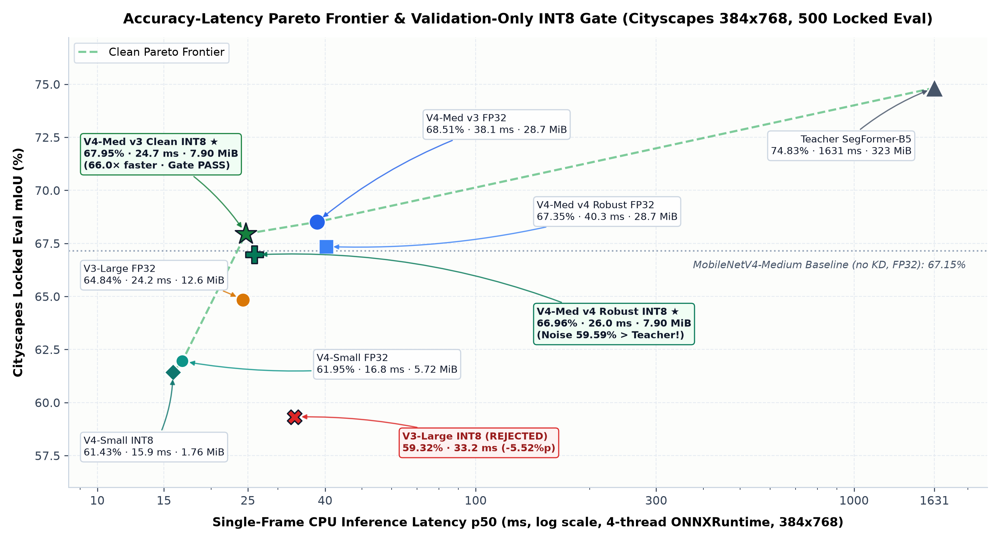

# 자율주행 도로 세그멘테이션 지식 증류 · `seg_kd`

[English](./README.md) · [설계 판단 및 과정](./docs/methodology-and-decisions.ko.md) · [아키텍처](./docs/architecture.ko.md) · [실험 결과](./docs/results.ko.md) · [원샷 검증 가이드](./docs/reproduction.ko.md) · [검증 요약 JSON](./reports/final-summary.json)

84.6M 파라미터의 Vision Transformer 교사(`SegFormer-B5`, `323.14 MiB`, CPU `0.61 FPS`)를 7.5M 경량 Edge CNN 학생(`MobileNetV4-Medium + FPN`, **ONNX INT8 `7.91 MiB`**, CPU **`40.49 FPS`**, NVIDIA L4 BF16 **`57.20 FPS`**)으로 압축하는 **이종 아키텍처 지식 증류(Cross-Architecture Knowledge Distillation)** 연구·배포 파이프라인입니다.

모든 분할(`train 2,529 / validation 446 / locked_eval 500`), 손실 소거, INT8 배포 게이트, 사후 온도 보정(`Temperature Scaling`)은 `validation` 전용으로 고정하고, `locked_eval`과 **KITTI Semantics Zero-Shot**(`200장`)은 SHA-256 해시 동결(`evaluation-freeze`) 후 단 한 번 평가했습니다. 특히 **깨끗한 교사 → 열화 입력 학생(Clean Teacher → Corrupted Student)** 비대칭 강건성 증류(`v4-final`)를 통해 **`7.91 MiB` INT8 학생이 가우시안 센서 노이즈(`σ=18`) 환경에서 `59.59% mIoU`를 기록해 11.2배 큰 `84.6M` 교사(`59.19%`)를 추월**했습니다.


---

## 실험 과정과 단계별 선택 이유

단순히 한 모델을 학습해 수치를 보고하는 대신, **가설 수립 → 정량 진단 → 실패 원인 규명 → 구조적 개선**의 6단계 의사결정 과정으로 파이프라인을 완성했습니다(전체 상세 분석: [`docs/methodology-and-decisions.ko.md`](./docs/methodology-and-decisions.ko.md)).

| 단계 | 핵심 질문 | 정량 진단 결과 | 설계 선택 및 기각 사유 |
| :--- | :--- | :--- | :--- |
| **1. 해상도·프로토콜** | CPU 40 FPS 엣지 예산에서 작은 안전 객체를 식별할 해상도는? | `Chris1/cityscapes` 원본 → `384×768` (`train 2,529 / val 446 / locked 500`) + KITTI 200장 Zero-Shot | **`384×768` 채택** (`128×256` 소형 객체 손실·`1024×2048` 비실시간 기각) |
| **2. 증류 손실 소거** | 픽셀 KL vs 공간 CWD vs 4단계 특징 정렬 중 무엇이 이종 ViT→CNN 압축에 유효한가? | `pixel_kl` **`-2.41%p` 역효과** (Safety `-5.71%p`) vs **`cwd` `63.07%` (`+1.42%p`, KITTI Safety `+7.12%p`)** | **`pixel_kl` 기각**, 채널별 공간 분포를 정렬하는 **`CWD` 채택** |
| **3. 3시드 쌍체 검증** | 단일 시드 우연이 아니며 안전 핵심 6종이 일관되게 오르는가? | 공유 초기화 3시드(`378/379/380`): **3/3 전승** (`+0.61%p`, Safety **`+1.88%p`**, **6/6 전원 상승**, SD `2.7~3.1×` 축소) | 안전 클래스 강화 및 분산 안정화 효과 입증 |
| **4. 3-Tier Pareto · INT8 게이트** | 어떤 백본이 정적 QDQ INT8에서 붕괴 없이 실제 CPU 가속을 달성하는가? | `V3-Large` INT8 **`-6.46%p`·`0.72×` 붕괴(자동 차단)**, `V4-Small` `1.04×` 미달(기각), **`V4-Medium` 4/4 통과 (`67.95%`, `40.49 FPS`)** | SE+HardSwish 비융합 구조 기각 → 순수 `Conv-BN-ReLU` UIB **`MobileNetV4-Medium INT8` 채택** |
| **5. 비대칭 강건성 KD (`v4`)** | `v3 Clean INT8`의 센서 노이즈 붕괴(`13.75%`)를 어떻게 해결할 것인가? | Clean 교사 → Corrupted 학생(5ep 램프) + BF16 QAT-KD → 노이즈 **`59.59%` (`+45.84%p` 회복, 교사 `59.19%` 추월)**, 안개 `66.33%` | 주간 최고 정확도(`v3`) vs 악천후 방어(`v4`) **2-프로파일 배포 확정** |
| **6. 사후 온도 보정 (`ECE`)** | CWD의 확률 과신(`ECE 0.025~0.031`)을 정확도·지연 손실 없이 교정할 수 있는가? | Validation NLL 최적화 시 모든 CWD 모델이 `T* = 1.70~1.72` 수렴 → **ECE `-69.5~78.5%`**, mIoU 변화 `0.00%p`, 지연 `0 ms` | 단일 스칼라 `T*` 온도 보정 표준 후처리 채택 |

---

## 핵심 검증 결과

### 1. Cityscapes 384×768 `locked_eval` (500장) · KITTI Zero-Shot (200장) · 배포 게이트

| 모델 | 포맷 | 파라미터 / 크기 | Locked mIoU | Safety-6 mIoU | KITTI Zero-Shot (Safety) | CPU p50 (4T) | INT8 게이트 |
|---|---|---:|---:|---:|---:|---:|:---:|
| **Teacher `SegFormer-B5`** | PyTorch BF16 | 84.6M / 323.14 MiB | **74.83%** | **65.57%** | 67.94% (54.62%) | 1631.33 ms (0.61 FPS) | 기준 교사 |
| `MobileNetV4-Medium` Baseline (무교사) | PyTorch FP32 | 7.54M / 29.19 MiB | 67.15% | 55.88% | 49.09% (25.63%) | — | 기준 학생 |
| `MobileNetV4-Small` CWD+Feat | ONNX FP32 | 1.50M / 5.72 MiB | 61.95% | 51.80% | 45.97% (26.08%) | 16.77 ms (59.63 FPS) | — |
| `MobileNetV4-Small` CWD+Feat | ONNX INT8 | 1.50M / 1.76 MiB | 61.43% | 51.42% | 46.44% (26.71%) | 15.85 ms (63.10 FPS) | 미통과 (1.04× < 1.20×) |
| `MobileNetV3-Large` CWD+Feat | ONNX FP32 | 3.30M / 12.59 MiB | 64.84% | 55.29% | — | 24.24 ms (41.25 FPS) | — |
| `MobileNetV3-Large` CWD+Feat | ONNX INT8 | 3.30M / 3.68 MiB | 59.32% | 49.99% | — | 33.18 ms (30.14 FPS) | **차단 (-6.46%p, 0.72×)** |
| **`MobileNetV4-Medium` Clean KD (`v3-max`)** | ONNX FP32 | 7.54M / 28.71 MiB | **68.51%** | **58.23%** | — | 38.11 ms (26.24 FPS) | — |
| **`MobileNetV4-Medium` Clean KD (`v3-max`)** | **ONNX INT8** | **7.54M / 7.91 MiB** | **67.95%** | **57.94%** | **51.32% (33.09%)** | **24.70 ms (40.49 FPS)** | **통과 (4/4 ALL PASS)** |
| **`MobileNetV4-Medium` Robust KD (`v4-final`)** | ONNX FP32 | 7.54M / 28.71 MiB | 67.35% | 58.14% | 50.04% (31.96%) | 40.28 ms (24.83 FPS) | — |
| **`MobileNetV4-Medium` Robust KD (`v4-final`)** | **ONNX INT8** | **7.54M / 7.91 MiB** | **66.96%** | **57.32%** | 48.10% (30.49%) | **26.02 ms (38.44 FPS)** | **통과 (4/4 ALL PASS)** |

- **주간 최고 성능(`v3-max` Clean INT8)**: 교사 대비 **11.2× 적은 파라미터 · 40.9× 작은 파일(`7.91 MiB`) · 66.0× 빠른 CPU 추론**(`40.49 FPS`)으로 교사 mIoU의 **90.8%**(`67.95% / 74.83%`)를 보존했습니다. 동일 아키텍처 무교사 FP32 베이스라인(`67.15%`, `28.71 MiB`)을 **`1/3.6` 크기 INT8 모델로 `+0.80%p` mIoU, `+2.06%p` Safety-6 mIoU, KITTI Zero-Shot `+2.23%p` (Safety `+7.46%p`) 앞섭니다.**



### 2. 비대칭 강건성 증류(`v4-final`) 악천후·센서 열화 스트레스 테스트 (200프레임)

| 모델 | Clean | 야간 저조도 | 모션 블러 (k=9) | 안개 저대비 | 가우시안 노이즈 (σ=18) | 노이즈 Safety-6 |
|---|---:|---:|---:|---:|---:|---:|
| Teacher `SegFormer-B5` (84.6M, 323 MiB) | 73.41% | 73.04% | 65.40% | 72.30% | 59.19% | 47.51% |
| `MobileNetV4-Medium` Baseline (7.5M, FP32) | 65.25% | 63.44% | 55.80% | 56.89% | 23.46% | 18.45% |
| `MobileNetV4-Medium` Clean INT8 (`v3-max`) | 67.40% | 64.14% | 58.45% | 59.76% | 13.75% | 10.10% |
| **`MobileNetV4-Medium` Robust FP32 (`v4-final`)** | 67.19% | **66.07%** | **60.56%** | **66.98%** | **60.61%** *(교사 +1.42%p)* | **48.00%** |
| **`MobileNetV4-Medium` Robust INT8 (`v4-final`)** | 66.89% | 64.71% | 59.37% | **66.33%** | **59.59%** *(교사 +0.40%p)* | **46.99%** |

- 깨끗한 입력만으로 증류한 `v3-max INT8`은 센서 노이즈에서 `13.75%`로 붕괴했지만, **교사에게는 깨끗한 원본 이미지를, 학생에게만 열화 이미지를 입력하는 비대칭 증류**(`v4-final`)로 노이즈 성능을 **`+45.84%p` 회복**(`13.75% → 59.59%`)하고 안개 저대비 성능을 **`+9.44%p` 향상**(`56.89% → 66.33%`)했습니다. Clean 구간 트레이드오프는 `0.50~0.99%p`에 불과합니다.


### 3. 3시드 쌍체 재현성 · 384×768 증류 기법 소거 · 사후 온도 보정(ECE)

- **3시드 쌍체 비교(`MobileNetV4-Small 1.50M`, seeds `378, 379, 380`)**: 동일 초기 가중치에서 `baseline` `61.42% ± 0.21%` → `cwd_feat` `62.03% ± 0.08%` (**`+0.61%p`, 3/3 승, 시드 분산 2.7× 축소**), Safety-6 mIoU `49.52% ± 0.90%` → `51.40% ± 0.29%` (**`+1.88%p`, 3/3 승, 분산 3.1× 축소**). 3시드 평균 기준 **6개 안전 핵심 클래스 6/6 전원 상승**(`traffic_light +2.75%p`, `bicycle +2.44%p`, `traffic_sign +2.11%p`, `person +1.59%p`, `rider +1.51%p`, `motorcycle +0.89%p`).
- **384×768 4종 증류 소거(`seed=378`, `1.50M`)**: 순진한 픽셀 KL(`pixel_kl`)은 `59.25%`(**`-2.41%p` 역효과**, Safety `-5.71%p`)로 무너진 반면, 채널별 공간 분포를 정렬하는 **CWD**(`cwd`)는 **`63.07%`**(`+1.42%p`, Safety `51.92%`, KITTI `47.38%` / Safety `+7.12%p`)를 달성했습니다.
- **Validation-Only 온도 보정(ECE)**: CWD 증류 모델 전체가 일관되게 `T* = 1.70~1.72` 범위로 수렴하며, mIoU `0.00%p` 변화·추론 지연 `0 ms`로 `locked_eval` ECE를 **69.5~78.5% 감소**시켰습니다(`v4 Robust INT8`: `0.0260 → 0.0067`, `-74.2%`; `v3 Clean INT8`: `0.0254 → 0.0073`, `-71.4%`).


---

## 원샷 검증 및 재현

의미 없는 합성 데이터 데모 대신, **실제 배포 ONNX INT8/FP32 모델([GitHub Release `v4.0-models`](https://github.com/Dongmyung378/Knowledge-Distillation/releases/tag/v4.0-models))과 동결 리포트를 원샷으로 검증**하거나 L4 GPU에서 전체 실험을 재현할 수 있습니다.

1. **원샷 자립형 노트북 (추천)**: [`notebooks/colab_enterprise_l4_one_shot.ipynb`](./notebooks/colab_enterprise_l4_one_shot.ipynb)를 Colab / Jupyter에 올리고 **모두 실행**(Run All)
   - `RUN_MODE = "verify_saved"` *(기본, CPU/GPU 1~3분)*: 내장 `seg_kd` 번들 SHA-256 검증 → 단위 테스트 12/12 → 배포 ONNX 모델 4종 자동 다운로드 & 동결 해시 100% 일치 확인 → CPU 4스레드 실시간 속도 실측 → *(옵션)* Cityscapes `locked_eval`·KITTI 라이브 재평가
   - `RUN_MODE = "reproduce_full"` *(NVIDIA L4 24GB)*: `Chris1/cityscapes` (`384×768`) + KITTI 자동 다운로드 및 `v3-max` + `v4-final` 전체 재학습·재현
2. **로컬 터미널 원샷 검증**:

```bash
pip install -e ".[export]"
python -m unittest discover -s tests -v
python scripts/verify_release_models.py --threads 4 --runs 20
```

자세한 단계별 절차는 [`docs/reproduction.ko.md`](./docs/reproduction.ko.md)를 참고하십시오.

---

## 저장소 구성

| 경로 | 설명 |
|---|---|
| [`seg_kd/`](./seg_kd/) | 핵심 PyTorch·ONNX 패키지 (`taxonomy`, `data`, `models`, `losses`, `training`, `export`, `evaluation`, `benchmark`, `visualize`, `cli`) |
| [`notebooks/colab_enterprise_l4_one_shot.ipynb`](./notebooks/colab_enterprise_l4_one_shot.ipynb) | 소스·동결 리포트 내장 원샷 검증(`verify_saved`) 및 L4 전체 재현(`reproduce_full`) 노트북 |
| [`scripts/verify_release_models.py`](./scripts/verify_release_models.py) | GitHub Release `v4.0-models` ONNX 모델 SHA-256 동결 검증 및 CPU 속도 실측 스크립트 |
| [`scripts/run_l4_study.py`](./scripts/run_l4_study.py) | 재개 가능한 단계별 학습 오케스트레이터 (`teacher → ablation → pareto → export → freeze → eval → plots`) |
| [`configs/l4-plan.json`](./configs/l4-plan.json) | `SegFormer-B5` → `MobileNetV4` 3시드·Pareto·비대칭 강건성 KD·INT8 게이트 고정 실험 계획 |
| [`reports/final-summary.json`](./reports/final-summary.json) | `v3-max` + `v4-final` 전체 정량 지표·동결 해시·게이트 판정 마스터 JSON |
| [`docs/`](./docs/methodology-and-decisions.ko.md) | 한/영 설계 판단·아키텍처·전체 결과·원샷 검증 가이드 (`methodology-and-decisions`, `architecture`, `results`, `reproduction`) |
| [`assets/figures/`](./assets/figures/) | 검증 차트 및 한/영 요약 SVG |
| [`tests/`](./tests/) | 12개 단위·무결성 테스트 수트 ([GitHub Actions CI](./.github/workflows/tests.yml) 자동 통과) |

---

## 적용 범위 및 한계

1. **해상도 범위 (`384×768`)**: 실시간 CPU 40 FPS 엣지 배포를 목표로 `384×768` 해상도에서 학습·평가했습니다. 공식 Cityscapes 고해상도 리더보드(`1024×2048`, 멀티스케일·TTA 포함) 수치와는 평가 조건이 다르므로 직접 1:1 비교하지 않습니다.
2. **합성 악천후 vs 실주행 악천후**: `v4-final` 강건성 테스트는 `locked_eval` 200프레임에 대한 결정론적 합성 열화(야간·블러·안개·가우시안 노이즈) 기준이며, 실제 우천·야간·폭설 도메인(ACDC, Dark Zurich 등) 일반화는 별도의 실주행 데이터 검증이 필요합니다.
3. **희소 대형 차량 트레이드오프 및 시드 범위**: 3시드 쌍체 검증은 `1.50M` 주력 모델에서 수행했으며, 6/6 안전 클래스가 모두 개선된 반면 빈도가 낮은 `truck(-7.32%p)`·`bus(-1.71%p)`에서 공간 분포 정규화 트레이드오프가 관측되었습니다. `MobileNetV4-Medium`과 `384×768` 4종 소거는 단일 시드(`seed=378`) 결과입니다.
4. **2-프로파일 배포 선택**: 맑은 주간 정확도 우선 시 `v3-max Clean INT8`(`67.95%`, `40.49 FPS`), 야간·안개·센서 노이즈 안전성 우선 시 `v4-final Robust INT8`(`66.96%` Clean / `59.59%` Noise, `38.44 FPS`)을 선택합니다.
