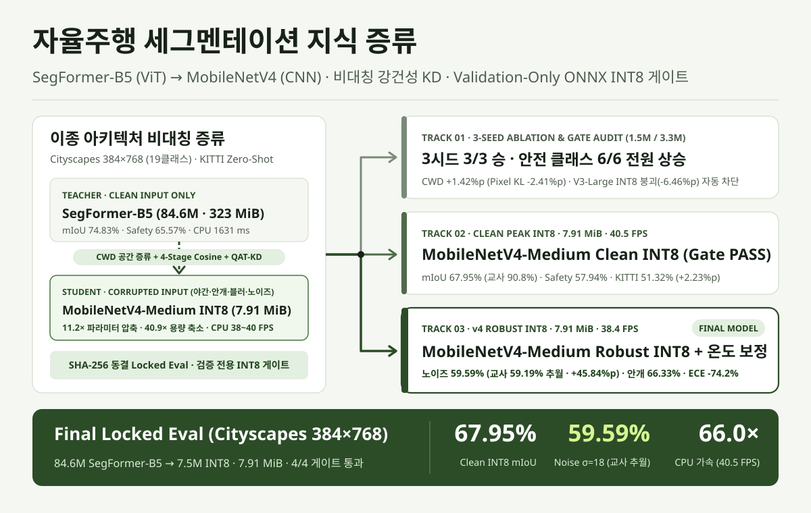
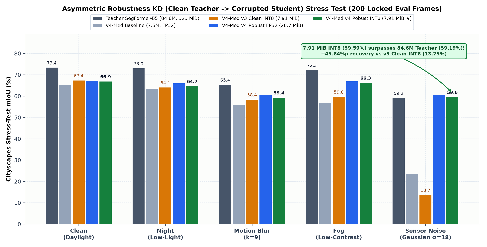
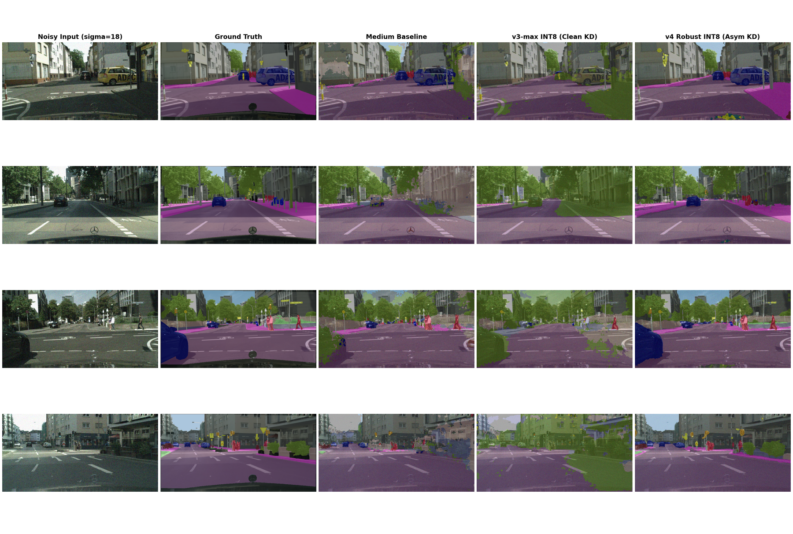
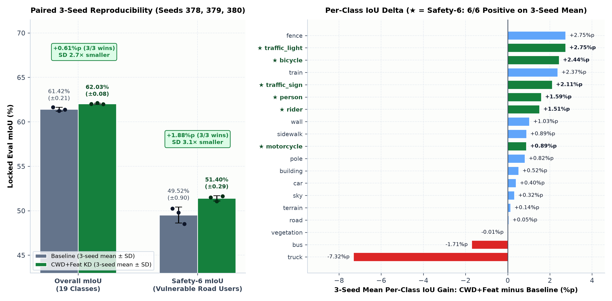

# 자율주행 도로 세그멘테이션 지식 증류 · `seg_kd`

[English](./README.md) · [아키텍처](./docs/architecture.ko.md) · [실험 결과](./docs/results.ko.md) · [재현 가이드](./docs/reproduction.ko.md) · [검증 요약 JSON](./reports/final-summary.json)

84.6M 파라미터의 Vision Transformer 교사(`SegFormer-B5`, `323.14 MiB`, CPU `0.61 FPS`)를 7.5M 경량 Edge CNN 학생(`MobileNetV4-Medium + FPN`, **ONNX INT8 `7.91 MiB`**, CPU **`40.49 FPS`**, NVIDIA L4 BF16 **`57.20 FPS`**)으로 압축하는 **이종 아키텍처 지식 증류(Cross-Architecture Knowledge Distillation)** 파이프라인입니다.

모든 분할(`train 2,529 / validation 446 / locked_eval 500`), 모델 선택, INT8 배포 게이트, 사후 온도 보정(`Temperature Scaling`)은 `validation` 전용으로 고정하고, `locked_eval`과 **KITTI Semantics Zero-Shot**(`200장`)은 SHA-256 해시 동결(`evaluation-freeze`) 후 단 한 번 평가했습니다. 특히 **깨끗한 교사 → 열화 입력 학생(Clean Teacher → Corrupted Student)** 비대칭 강건성 증류(`v4-final`)를 통해 **`7.91 MiB` INT8 학생이 가우시안 센서 노이즈(`σ=18`) 환경에서 `59.59% mIoU`를 기록해 11.2배 큰 `84.6M` 교사(`59.19%`)를 추월**했습니다.



---

## 핵심 검증 결과

### 1. Cityscapes 384×768 `locked_eval` (500장) · KITTI Zero-Shot (200장) · 배포 게이트

| 모델 | 포맷 | 파라미터 / 크기 | Locked mIoU | Safety-6 mIoU | KITTI Zero-Shot (Safety) | CPU p50 (4T) | INT8 게이트 |
|---|---|---:|---:|---:|---:|---:|:---:|
| **Teacher `SegFormer-B5`** | PyTorch BF16 | 84.6M / 323.14 MiB | **74.83%** | **65.57%** | 67.94% (54.62%) | 1631.33 ms (0.61 FPS) | 기준 교사 |
| `MobileNetV4-Medium` Baseline (무교사) | PyTorch FP32 | 7.54M / 29.19 MiB | 67.15% | 55.88% | 49.09% (25.63%) | — | 기준 학생 |
| `MobileNetV4-Small` CWD+Feat | ONNX FP32 | 1.50M / 5.72 MiB | 61.95% | 51.80% | 45.97% (26.08%) | 16.77 ms (59.63 FPS) | — |
| `MobileNetV4-Small` CWD+Feat | ONNX INT8 | 1.50M / 1.76 MiB | 61.43% | 51.42% | 46.44% (26.71%) | 15.85 ms (63.10 FPS) | 미통과 (1.04× < 1.20×) |
| `MobileNetV3-Large` CWD+Feat | ONNX FP32 | 3.30M / 12.59 MiB | 64.84% | 55.29% | — | 24.24 ms (41.25 FPS) | — |
| `MobileNetV3-Large` CWD+Feat | ONNX INT8 | 3.30M / 3.68 MiB | 59.32% | 49.99% | — | 33.18 ms (30.14 FPS) | **차단 (-6.46%p, 0.72×)** |
| **`MobileNetV4-Medium` Clean KD (`v3-max`)** | ONNX FP32 | 7.54M / 28.71 MiB | **68.51%** | **58.23%** | — | 38.11 ms (26.24 FPS) | — |
| **`MobileNetV4-Medium` Clean KD (`v3-max`)** | **ONNX INT8** | **7.54M / 7.91 MiB** | **67.95%** | **57.94%** | **51.32% (33.09%)** | **24.70 ms (40.49 FPS)** | **통과 (4/4 ALL PASS)** |
| **`MobileNetV4-Medium` Robust KD (`v4-final`)** | ONNX FP32 | 7.54M / 28.71 MiB | 67.35% | 58.14% | 50.04% (31.96%) | 40.28 ms (24.83 FPS) | — |
| **`MobileNetV4-Medium` Robust KD (`v4-final`)** | **ONNX INT8** | **7.54M / 7.91 MiB** | **66.96%** | **57.32%** | 48.10% (30.49%) | **26.02 ms (38.44 FPS)** | **통과 (4/4 ALL PASS)** |

- **주간 최고 성능(`v3-max` Clean INT8)**: 교사 대비 **11.2× 적은 파라미터 · 40.9× 작은 파일(`7.91 MiB`) · 66.0× 빠른 CPU 추론**(`40.49 FPS`)으로 교사 mIoU의 **90.8%**(`67.95% / 74.83%`)를 보존했습니다. 동일 아키텍처 무교사 FP32 베이스라인(`67.15%`, `28.71 MiB`)을 **`1/3.6` 크기 INT8 모델로 `+0.80%p` mIoU, `+2.06%p` Safety-6 mIoU, KITTI Zero-Shot `+2.23%p` (Safety `+7.46%p`) 앞섭니다.**
- **Validation-Only INT8 자동 게이트 검증**: `MobileNetV3-Large`는 18개 Squeeze-and-Excitation(SE) + HardSwish 비융합 경로 때문에 정적 INT8에서 검증 mIoU가 **`-6.46%p`** 붕괴하고 속도가 **`0.72×`** 느려졌습니다. 자동 배포 게이트가 `locked_eval`을 열어보기 전에 이를 차단해 FP32로 안전 롤백한 반면, `Conv-BN-ReLU` UIB 블록 기반의 `MobileNetV4-Medium`은 두 버전 모두 4/4 조건(검증 mIoU 하락 `<=1.0%p`, Safety 하락 `<=1.5%p`, 용량 감소, CPU `>=1.2×` 가속)을 통과했습니다.


### 2. 비대칭 강건성 증류(`v4-final`) 악천후·센서 열화 스트레스 테스트 (200프레임)

| 모델 | Clean | 야간 저조도 | 모션 블러 (k=9) | 안개 저대비 | 가우시안 노이즈 (σ=18) | 노이즈 Safety-6 |
|---|---:|---:|---:|---:|---:|---:|
| Teacher `SegFormer-B5` (84.6M, 323 MiB) | 73.41% | 73.04% | 65.40% | 72.30% | 59.19% | 47.51% |
| `MobileNetV4-Medium` Baseline (7.5M, FP32) | 65.25% | 63.44% | 55.80% | 56.89% | 23.46% | 18.45% |
| `MobileNetV4-Medium` Clean INT8 (`v3-max`) | 67.40% | 64.14% | 58.45% | 59.76% | 13.75% | 10.10% |
| **`MobileNetV4-Medium` Robust FP32 (`v4-final`)** | 67.19% | **66.07%** | **60.56%** | **66.98%** | **60.61%** *(교사 +1.42%p)* | **48.00%** |
| **`MobileNetV4-Medium` Robust INT8 (`v4-final`)** | 66.89% | 64.71% | 59.37% | **66.33%** | **59.59%** *(교사 +0.40%p)* | **46.99%** |

- 깨끗한 입력만으로 증류한 `v3-max INT8`은 센서 노이즈에서 `13.75%`로 붕괴했지만, **교사에게는 깨끗한 원본 이미지를, 학생에게만 열화 이미지를 입력하는 비대칭 증류**(`v4-final`)로 노이즈 성능을 **`+45.84%p` 회복**(`13.75% → 59.59%`)하고 안개 저대비 성능을 **`+9.44%p` 향상**(`56.89% → 66.33%`)했습니다. Clean 구간 트레이드오프는 `0.50~0.99%p`에 불과합니다.





### 3. 3시드 쌍체 재현성 · 384×768 증류 기법 소거 · 사후 온도 보정(ECE)

- **3시드 쌍체 비교(`MobileNetV4-Small 1.50M`, seeds `378, 379, 380`)**: 동일 초기 가중치에서 `baseline` `61.42% ± 0.21%` → `cwd_feat` `62.03% ± 0.08%` (**`+0.61%p`, 3/3 승, 시드 분산 2.7× 축소**), Safety-6 mIoU `49.52% ± 0.90%` → `51.40% ± 0.29%` (**`+1.88%p`, 3/3 승, 분산 3.1× 축소**). 3시드 평균 기준 **6개 안전 핵심 클래스 6/6 전원 상승**(`traffic_light +2.75%p`, `bicycle +2.44%p`, `traffic_sign +2.11%p`, `person +1.59%p`, `rider +1.51%p`, `motorcycle +0.89%p`).
- **384×768 4종 증류 소거(`seed=378`, `1.50M`)**: 순진한 픽셀 KL(`pixel_kl`)은 `59.25%`(**`-2.41%p` 역효과**, Safety `-5.71%p`)로 무너진 반면, 채널별 공간 분포를 정렬하는 **CWD**(`cwd`)는 **`63.07%`**(`+1.42%p`, Safety `51.92%`, KITTI `47.38%` / Safety `+7.12%p`)를 달성했습니다. `56×` 극한 압축(`84.6M → 1.5M`)에서는 중간 특징 강제 정렬(`cwd_feat`, `62.00%`)보다 공간 로짓 CWD 단독이 더 큰 이득을 냅니다.
- **Validation-Only 온도 보정(ECE)**: CWD 증류 모델 전체가 일관되게 `T* = 1.70~1.72` 범위로 수렴하며, mIoU `0.00%p` 변화·추론 지연 `0 ms`로 `locked_eval` ECE를 **69.5~78.5% 감소**시켰습니다(`v4 Robust INT8`: `0.0260 → 0.0067`, `-74.2%`; `v3 Clean INT8`: `0.0254 → 0.0073`, `-71.4%`).



---

## 시스템 구조 및 핵심 기법

```
Cityscapes 384×768 (train 2,529 / val 446 / locked_eval 500) + KITTI Zero-Shot (200)
   │
   ├─ Clean RGB ──▶ Frozen SegFormer-B5 Teacher (84.6M, MiT-B5, BF16)
   │                     └─ 4-Stage Features (s4, s8, s16, s32) + Clean Logits (19ch)
   │
   └─ Clean / Corrupted RGB ──▶ MobileNetV4-Medium + FPN Student (7.54M, UIB Conv-BN-ReLU)
                                  ├─ L_CE (unweighted, ignore_index=255)
                                  ├─ L_CWD (Channel-wise Spatial Softmax KL over H×W, T=4.0)
                                  ├─ L_Feat (1×1 Projector Bank: 0.5·CWD + 0.5·Cosine across 4 stages)
                                  └─ BF16-Teacher QAT-KD (6 ep) ─▶ ONNX FP32/INT8 (QDQ, 128-img Calib)
                                                                       ├─ Validation-Only INT8 Gate (4/4)
                                                                       ├─ Validation-Only Temp Scaling (T*≈1.70)
                                                                       └─ SHA-256 Frozen Locked Eval & KITTI
```

1. **Channel-Wise Spatial Distillation (`CWD`)**: 클래스 픽셀 불균형이 극심한 도로 장면에서 픽셀별 KL(`softmax` over `C`)은 소수 안전 클래스를 희석합니다. 채널별 공간 맵(`softmax` over `H×W`)을 정렬해 신호등·보행자·자전거 경계를 선명하게 전이합니다.
2. **이종 아키텍처 4단계 하이브리드 특징 정렬**: Transformer(`SegFormer-B5`)와 CNN(`MobileNetV4`)의 `s4, s8, s16, s32` 피라미드 채널 차원을 학습 시에만 존재하는 `1×1 Conv-BN` 프로젝터로 정합하고(`추론 오버헤드 0`), `0.5·CWD + 0.5·Cosine` 복합 손실로 정렬합니다.
3. **비대칭 강건성 증류 (`Asymmetric Robustness KD`)**: 5에포크 램프 스케줄(`p: 0 → 0.35`)로 학생 입력에만 GPU 배치 야간 감마·모션 블러·안개 저대비·가우시안 노이즈를 주입하고, 교사는 항상 깨끗한 원본 입력을 봐 "열화되어도 깨끗한 장면의 특징과 로짓을 복원"하도록 학습합니다.
4. **양자화 친화 설계 감사 & 검증 전용 INT8 게이트**: `audit_quantization_friendliness()`로 `Conv-ReLU-BN` 비융합 패턴을 사전 검출하고, QAT-KD 후 정적 QDQ INT8 모델을 `validation` 기준 4개 정량 게이트로 심사해 `locked_eval` 누설 없이 배포 포맷을 자동 선택합니다.

세부 수식과 모듈 설계는 [`docs/architecture.ko.md`](./docs/architecture.ko.md), 전체 실험표와 실패 분석은 [`docs/results.ko.md`](./docs/results.ko.md)를 참고하십시오.

---

## 로컬 실행 및 재현

```bash
# 1. 환경 설치 및 진단
pip install -e ".[export]"
python -m seg_kd doctor

# 2. 단위 테스트 및 1분 End-to-End 파이프라인 스모크 테스트
python -m unittest discover -s tests -v
python scripts/run_l4_study.py --plan configs/l4-plan.json --manifest /tmp/syn-manifest.json --data /tmp/syn-data --output /tmp/syn-out --smoke
```

전체 NVIDIA L4 실험은 자립형 노트북 [`notebooks/colab_enterprise_l4_one_shot.ipynb`](./notebooks/colab_enterprise_l4_one_shot.ipynb)의 `Run All` 한 번으로 재현할 수 있습니다. 자세한 단계별 CLI와 데이터 준비 절차는 [`docs/reproduction.ko.md`](./docs/reproduction.ko.md)를 참고하십시오.

---

## 소프트웨어 검증

- **단위·통합 테스트 (`unittest`, 12/12 PASS)**:
  - `tests/test_taxonomy_and_data.py`: Cityscapes 19클래스 `labelId → trainId` 매핑, 도시 분리 분할, SHA-256 매니페스트 변조 탐지, KITTI/BDD100K 레이아웃 검증
  - `tests/test_models.py`: `Conv-ReLU-BN` 양자화 안티패턴 감사, 4단계 피라미드 정렬, `SegFormer-B4/B5` 오프라인 설정·체크포인트 SHA-256 왕복 및 TorchScript 추적
  - `tests/test_losses.py`: `ignore_index=255` 마스킹 불변성, 자기 증류 0-KL 불변성, BF16 혼합정밀도 유한 그래디언트 (`pixel_kl`, `cwd`, `cwd_feat`, `cwd_safety`)
  - `tests/test_pipeline_smoke.py`: 합성 도로 장면 기준 교사 → 공유 초기화 쌍체 학생 → QAT → ONNX FP32/INT8 → 동결 → `locked_eval` → 사후 온도 보정 전체 파이프라인 스모크
- **CI 자동화**: [`.github/workflows/tests.yml`](./.github/workflows/tests.yml)에서 푸시 및 PR마다 전체 테스트 수트를 자동 검증합니다.

---

## 저장소 구성

| 경로 | 설명 |
|---|---|
| [`seg_kd/`](./seg_kd/) | 핵심 PyTorch·ONNX 패키지 (`taxonomy`, `data`, `models`, `losses`, `training`, `export`, `evaluation`, `benchmark`, `visualize`, `cli`) |
| [`configs/l4-plan.json`](./configs/l4-plan.json) | `SegFormer-B5` → `MobileNetV4` 3시드·Pareto·비대칭 강건성 KD·INT8 게이트 고정 실험 계획 |
| [`scripts/run_l4_study.py`](./scripts/run_l4_study.py) | 재개 가능한 단계별 오케스트레이터 (`teacher → ablation → pareto → export → freeze → eval → plots`) |
| [`scripts/generate_reports_and_figures.py`](./scripts/generate_reports_and_figures.py) | 검증 JSON 집계 및 겹침 없는 포트폴리오 차트·SVG 생성 스크립트 |
| [`notebooks/colab_enterprise_l4_one_shot.ipynb`](./notebooks/colab_enterprise_l4_one_shot.ipynb) | 소스 코드 SHA-256 번들 내장 Vertex AI Colab Enterprise (L4) 원샷 실행 노트북 |
| [`reports/final-summary.json`](./reports/final-summary.json) | `v3-max` + `v4-final` 전체 정량 지표·동결 해시·게이트 판정 마스터 JSON |
| [`docs/`](./docs/results.ko.md) | 한/영 아키텍처·전체 결과·재현 가이드 (`architecture`, `results`, `reproduction`) |
| [`assets/figures/`](./assets/figures/) | 논문·포트폴리오용 검증 차트 및 한/영 요약 SVG |
| [`tests/`](./tests/) | 12개 단위·스모크 테스트 수트 |

---

## 적용 범위 및 한계

1. **해상도 범위 (`384×768`)**: 실시간 CPU 40 FPS 엣지 배포를 목표로 `384×768` 해상도에서 학습·평가했습니다. 공식 Cityscapes 고해상도 리더보드(`1024×2048`, 멀티스케일·TTA 포함) 수치와는 평가 조건이 다르므로 직접 1:1 비교할 수 없습니다.
2. **합성 악천후 vs 실주행 악천후**: `v4-final` 강건성 테스트는 `locked_eval` 200프레임에 대한 결정론적 합성 열화(야간·블러·안개·가우시안 노이즈) 기준입니다. 실제 야간 우천·눈길 주행 검증(예: ACDC, Dark Zurich)은 추가 수집 후속 과제로 남아 있습니다.
3. **희소 대형 차량 트레이드오프 및 시드 범위**: 3시드 쌍체 검증은 `1.50M` 주력 모델에서 수행했으며, 6/6 안전 클래스가 모두 개선된 반면 빈도가 낮은 `truck(-7.32%p)`·`bus(-1.71%p)`에서 공간 분포 정규화 트레이드오프가 관측되었습니다. `MobileNetV4-Medium`과 `384×768` 4종 소거는 단일 시드(`seed=378`) 결과입니다.
4. **배포 선택 트레이드오프**: 맑은 주간 정확도 우선 시 `v3-max Clean INT8`(`67.95%`, `40.49 FPS`), 야간·안개·센서 노이즈 안전성 우선 시 `v4-final Robust INT8`(`66.96%` Clean / `59.59%` Noise, `38.44 FPS`)을 선택하는 2-프로파일 구성을 권장합니다.
