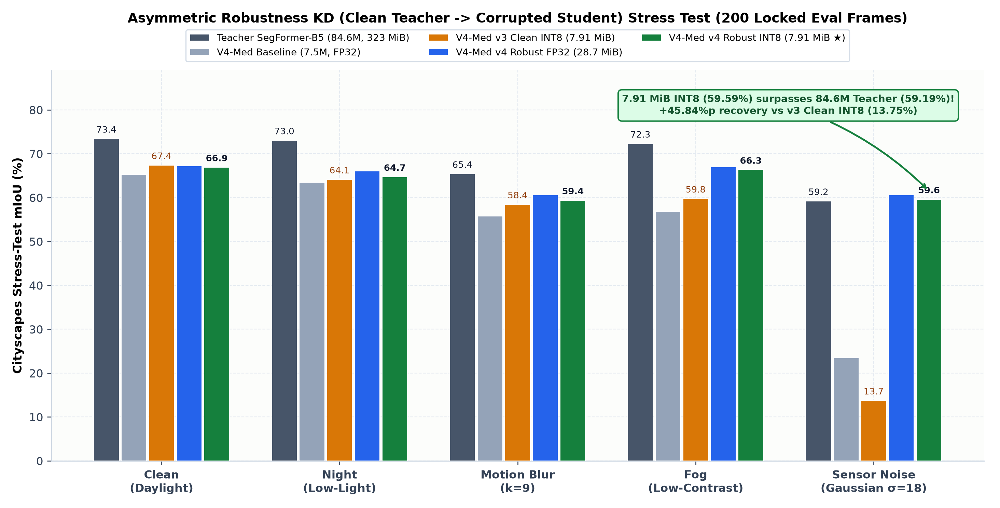

# Driving Semantic Segmentation Knowledge Distillation · `seg_kd`

[한국어](./README.ko.md) · [Methodology & Decisions](./docs/methodology-and-decisions.md) · [Architecture](./docs/architecture.md) · [Results](./docs/results.md) · [Verification Guide](./docs/reproduction.md) · [Summary JSON](./reports/final-summary.json)

A cross-architecture knowledge distillation research & deployment pipeline compressing an **84.6M Vision Transformer teacher** (`SegFormer-B5`, `323.14 MiB`, `0.61 FPS` CPU) into a **7.54M Edge CNN student** (`MobileNetV4-Medium + FPN`, **ONNX INT8 `7.91 MiB`**, **`40.49 FPS`** CPU, **`57.20 FPS`** NVIDIA L4 BF16) for autonomous driving road-scene segmentation.

All dataset splits (`train 2,529 / validation 446 / locked_eval 500`), loss ablations, INT8 deployment gating, and post-hoc temperature scaling are strictly fit on `validation` only, while `locked_eval` and **KITTI Semantics Zero-Shot (`200` images)** are evaluated once after SHA-256 cryptographic freezing. Using **Asymmetric Robustness KD (`v4-final`: Clean Teacher → Corrupted Student)**, the **`7.91 MiB` INT8 student achieves `59.59% mIoU` under Gaussian sensor noise (`σ=18`), surpassing the `11.2×` larger `84.6M` teacher (`59.19%`)**.


---

## Experimental Progression & Design Rationale

Every architectural, loss, quantization, and calibration choice was derived from staged diagnostics rather than guesswork (full analysis in [`docs/methodology-and-decisions.md`](./docs/methodology-and-decisions.md)):

| Stage | Core Question | Measured Evidence | Decision |
| :--- | :--- | :--- | :--- |
| **1. Resolution & Protocol** | Minimum resolution preserving small safety classes within a 40 FPS CPU edge budget? | `Chris1/cityscapes` full-res → `384×768` (`2,529 / 446 / 500`) + KITTI 200 zero-shot | **Adopt `384×768`** + SHA-256 freeze |
| **2. Loss Ablation (`1.50M`)** | Pixel KL vs Spatial CWD vs 4-Stage Feature KD under `56×` ViT→CNN compression? | `pixel_kl` **`-2.41%p`** (Safety `-5.71%p`) vs **`cwd` `63.07%` (`+1.42%p`, KITTI Safety `+7.12%p`)** | **Reject `pixel_kl`**; adopt spatial `CWD` |
| **3. 3-Seed Paired Study** | Are gains reproducible across seeds and across all 6 vulnerable road-user classes? | Shared-init 3-seed (`378/379/380`): **3/3 wins** (`+0.61%p`, Safety **`+1.88%p`**, **6/6 positive**, `2.7–3.1×` lower SD) | Reproducibility confirmed |
| **4. 3-Tier Pareto & INT8 Gate** | Which backbone delivers real CPU speedup in static QDQ INT8 without accuracy collapse? | `V3-Large` **`-6.46%p` / `0.72×` (blocked)**; `V4-Small` `1.04× < 1.20×` (rejected); **`V4-Medium` 4/4 PASS (`67.95%`, `40.49 FPS`)** | **Adopt `MobileNetV4-Medium INT8`** (pure UIB `Conv-BN-ReLU`) |
| **5. Asymmetric Robust KD (`v4`)** | How to fix clean INT8's collapse (`13.75%`) under Gaussian sensor noise? | Clean Teacher → Corrupted Student + BF16 QAT-KD → **`59.59%` noise (`+45.84%p`, beats 84.6M teacher `59.19%`)**, Fog `66.33%` | **Two-profile deployment** (`v3 Clean` vs `v4 Robust`) |
| **6. Temperature Scaling (`ECE`)** | Can CWD confidence over-sharpening (`ECE 0.025–0.031`) be fixed at zero latency/mIoU cost? | Validation-only fit converges to `T* = 1.70–1.72` → **ECE `-69.5–78.5%`**, `0.00%p` mIoU delta, `0 ms` overhead | Adopt scalar `T*` post-processing |

---

## Verified Headline Results

### 1. Cityscapes 384×768 `locked_eval` (500 imgs) · KITTI Zero-Shot (200 imgs) · INT8 Gate

| Model | Format | Params / Size | Locked mIoU | Safety-6 mIoU | KITTI Zero-Shot (Safety) | CPU p50 (4T) | INT8 Gate |
|---|---|---:|---:|---:|---:|---:|:---:|
| **Teacher `SegFormer-B5`** | PyTorch BF16 | 84.6M / 323.14 MiB | **74.83%** | **65.57%** | 67.94% (54.62%) | 1631.33 ms (0.61 FPS) | Teacher |
| `MobileNetV4-Medium` Baseline (no KD) | PyTorch FP32 | 7.54M / 29.19 MiB | 67.15% | 55.88% | 49.09% (25.63%) | — | Baseline |
| `MobileNetV4-Small` CWD+Feat | ONNX FP32 | 1.50M / 5.72 MiB | 61.95% | 51.80% | 45.97% (26.08%) | 16.77 ms (59.63 FPS) | — |
| `MobileNetV4-Small` CWD+Feat | ONNX INT8 | 1.50M / 1.76 MiB | 61.43% | 51.42% | 46.44% (26.71%) | 15.85 ms (63.10 FPS) | Rejected (1.04× < 1.20×) |
| `MobileNetV3-Large` CWD+Feat | ONNX FP32 | 3.30M / 12.59 MiB | 64.84% | 55.29% | — | 24.24 ms (41.25 FPS) | — |
| `MobileNetV3-Large` CWD+Feat | ONNX INT8 | 3.30M / 3.68 MiB | 59.32% | 49.99% | — | 33.18 ms (30.14 FPS) | **Blocked (-6.46%p, 0.72×)** |
| **`MobileNetV4-Medium` Clean KD (`v3-max`)** | ONNX FP32 | 7.54M / 28.71 MiB | **68.51%** | **58.23%** | — | 38.11 ms (26.24 FPS) | — |
| **`MobileNetV4-Medium` Clean KD (`v3-max`)** | **ONNX INT8** | **7.54M / 7.91 MiB** | **67.95%** | **57.94%** | **51.32% (33.09%)** | **24.70 ms (40.49 FPS)** | **PASS (4/4 Checks)** |
| **`MobileNetV4-Medium` Robust KD (`v4-final`)** | ONNX FP32 | 7.54M / 28.71 MiB | 67.35% | 58.14% | 50.04% (31.96%) | 40.28 ms (24.83 FPS) | — |
| **`MobileNetV4-Medium` Robust KD (`v4-final`)** | **ONNX INT8** | **7.54M / 7.91 MiB** | **66.96%** | **57.32%** | 48.10% (30.49%) | **26.02 ms (38.44 FPS)** | **PASS (4/4 Checks)** |


### 2. Asymmetric Robustness KD (`v4-final`) 4-Corruption Stress Test (200 Frames)

| Model | Clean | Night Low-Light | Motion Blur (k=9) | Fog Low-Contrast | Sensor Noise (σ=18) | Noise Safety-6 |
|---|---:|---:|---:|---:|---:|---:|
| Teacher `SegFormer-B5` (84.6M, 323 MiB) | 73.41% | 73.04% | 65.40% | 72.30% | 59.19% | 47.51% |
| `MobileNetV4-Medium` Baseline (7.5M, FP32) | 65.25% | 63.44% | 55.80% | 56.89% | 23.46% | 18.45% |
| `MobileNetV4-Medium` Clean INT8 (`v3-max`) | 67.40% | 64.14% | 58.45% | 59.76% | 13.75% | 10.10% |
| **`MobileNetV4-Medium` Robust FP32 (`v4-final`)** | 67.19% | **66.07%** | **60.56%** | **66.98%** | **60.61%** *(+1.42%p vs Teacher)* | **48.00%** |
| **`MobileNetV4-Medium` Robust INT8 (`v4-final`)** | 66.89% | 64.71% | 59.37% | **66.33%** | **59.59%** *(+0.40%p vs Teacher)* | **46.99%** |




---

## One-Shot Verification & Reproduction

Instead of toy synthetic demos, verify the **published SHA-256 frozen ONNX FP32/INT8 models ([GitHub Release `v4.0-models`](https://github.com/Dongmyung378/Knowledge-Distillation/releases/tag/v4.0-models))** directly or retrain on an NVIDIA L4:

1. **One-Shot Self-Contained Notebook (Recommended)**: Open [`notebooks/colab_enterprise_l4_one_shot.ipynb`](./notebooks/colab_enterprise_l4_one_shot.ipynb) in Colab or Jupyter and click **Run All**:
   - `RUN_MODE = "verify_saved"` *(default, CPU/GPU 1–3 min)*: Verifies embedded `seg_kd` SHA-256 bundle → passes 12/12 unit tests → downloads & SHA-256-verifies all 4 frozen ONNX models → runs live 4-thread CPU latency benchmarks → *(optional)* runs live Cityscapes `locked_eval` & KITTI re-evaluation.
   - `RUN_MODE = "reproduce_full"` *(NVIDIA L4 24GB)*: Downloads `Chris1/cityscapes` (`384×768`) + KITTI and retrains the complete `v3-max` + `v4-final` study end-to-end.
2. **Local Terminal One-Shot Verification**:

```bash
pip install -e ".[export]"
python -m unittest discover -s tests -v
python scripts/verify_release_models.py --threads 4 --runs 20
```

See [`docs/reproduction.md`](./docs/reproduction.md) for full artifact checksums and details.

---

## Repository Layout

| Path | Description |
|---|---|
| [`seg_kd/`](./seg_kd/) | Core PyTorch & ONNX package (`taxonomy`, `data`, `models`, `losses`, `training`, `export`, `evaluation`, `benchmark`, `visualize`, `cli`) |
| [`notebooks/colab_enterprise_l4_one_shot.ipynb`](./notebooks/colab_enterprise_l4_one_shot.ipynb) | Self-contained one-shot verification (`verify_saved`) & L4 reproduction (`reproduce_full`) notebook |
| [`scripts/verify_release_models.py`](./scripts/verify_release_models.py) | SHA-256 freeze verification & live CPU ONNXRuntime benchmark script for `v4.0-models` |
| [`scripts/run_l4_study.py`](./scripts/run_l4_study.py) | Resumable staged orchestrator (`teacher → ablation → pareto → export → freeze → eval → plots`) |
| [`configs/l4-plan.json`](./configs/l4-plan.json) | Frozen L4 experimental plan (`SegFormer-B5` → `MobileNetV4`, 3-seed, Pareto, Asymmetric Robust KD, INT8 gate) |
| [`reports/final-summary.json`](./reports/final-summary.json) | Canonical master JSON combining `v3-max` + `v4-final` metrics, freeze hashes, and INT8 gates |
| [`docs/`](./docs/methodology-and-decisions.md) | Bilingual technical docs (`methodology-and-decisions`, `architecture`, `results`, `reproduction`) |
| [`assets/figures/`](./assets/figures/) | Verified publication charts & bilingual hero SVGs |
| [`tests/`](./tests/) | 12-test unit & integrity suite (automated via [GitHub Actions CI](./.github/workflows/tests.yml)) |

---

## Scope & Limitations

1. **Resolution (`384×768`)**: Models are trained and evaluated at `384×768` for real-time 40 FPS CPU edge deployment; numbers are not directly comparable to full-resolution `1024×2048` multi-scale TTA Cityscapes leaderboard entries.
2. **Synthetic vs. Real Adverse Weather**: The 4-corruption stress test evaluates deterministic corruptions on 200 `locked_eval` frames; real adverse-weather driving benchmarks (e.g., ACDC, Dark Zurich) remain future work.
3. **Rare Large-Vehicle Trade-Off & Seed Coverage**: 3-seed paired verification covers the `1.50M` student (6/6 safety classes improved, rare `truck -7.32%p` / `bus -1.71%p` trade-off); `MobileNetV4-Medium` and the `384×768` 4-method ablation are single-seed (`seed=378`).
4. **Two-Profile Deployment Choice**: Choose `v3-max Clean INT8` (`67.95%`, `40.49 FPS`) for clean-daylight peak mIoU or `v4-final Robust INT8` (`66.96%` clean / `59.59%` noise, `38.44 FPS`) when night, fog, and sensor-noise resilience are prioritized.
