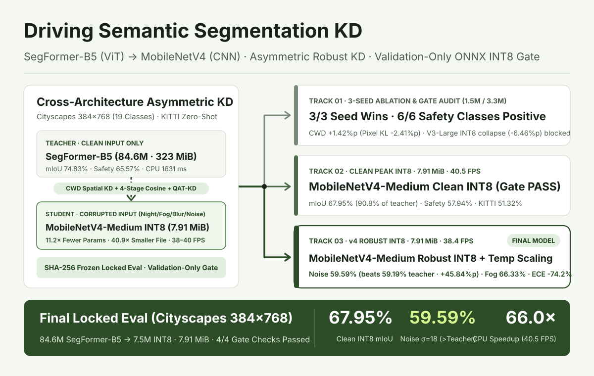
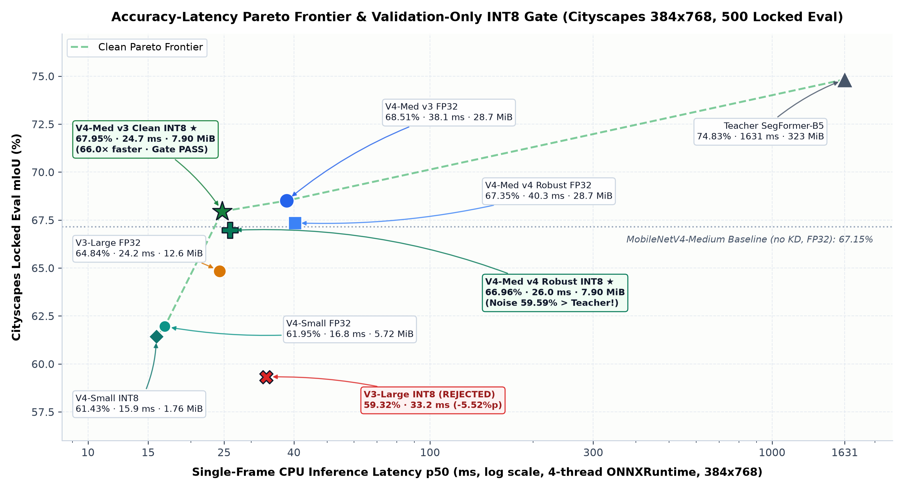
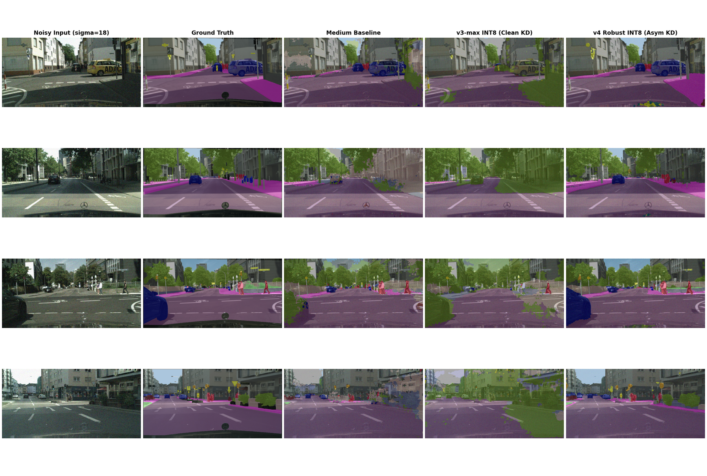
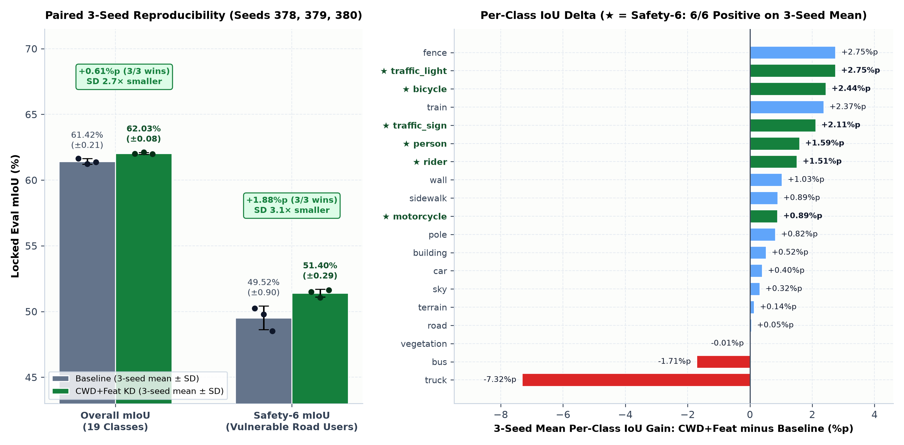

# Driving Semantic Segmentation Knowledge Distillation · `seg_kd`

[한국어](./README.ko.md) · [Architecture](./docs/architecture.md) · [Results](./docs/results.md) · [Reproduction](./docs/reproduction.md) · [Summary JSON](./reports/final-summary.json)

A cross-architecture knowledge distillation pipeline that compresses an **84.6M Vision Transformer teacher** (`SegFormer-B5`, `323.14 MiB`, `0.61 FPS` CPU) into a **7.54M Edge CNN student** (`MobileNetV4-Medium + FPN`, **ONNX INT8 `7.91 MiB`**, **`40.49 FPS`** CPU, **`57.20 FPS`** NVIDIA L4 BF16) for autonomous driving road-scene segmentation.

All dataset splits (`train 2,529 / validation 446 / locked_eval 500`), model selection, INT8 deployment gating, and post-hoc temperature scaling are strictly fit on `validation` only, while `locked_eval` and **KITTI Semantics Zero-Shot (`200` images)** are evaluated once after SHA-256 cryptographic freezing. Using **Asymmetric Robustness KD (`v4-final`: Clean Teacher → Corrupted Student)**, the **`7.91 MiB` INT8 student achieves `59.59% mIoU` under Gaussian sensor noise (`σ=18`), surpassing the `11.2×` larger `84.6M` teacher (`59.19%`)**.



---

## Verified Headline Results

### 1. Cityscapes 384×768 `locked_eval` (500 imgs) · KITTI Zero-Shot (200 imgs) · INT8 Gate

| Model | Format | Params / Size | Locked mIoU | Safety-6 mIoU | KITTI Zero-Shot (Safety) | CPU p50 (4T) | INT8 Gate |
|---|---|---:|---:|---:|---:|---:|:---:|
| **Teacher `SegFormer-B5`** | PyTorch BF16 | 84.6M / 323.14 MiB | **74.83%** | **65.57%** | 67.94% (54.62%) | 1631.33 ms (0.61 FPS) | Teacher |
| `MobileNetV4-Medium` Baseline (no KD) | PyTorch FP32 | 7.54M / 29.19 MiB | 67.15% | 55.88% | 49.09% (25.63%) | — | Baseline |
| `MobileNetV4-Small` CWD+Feat | ONNX FP32 | 1.50M / 5.72 MiB | 61.95% | 51.80% | 45.97% (26.08%) | 16.77 ms (59.63 FPS) | — |
| `MobileNetV4-Small` CWD+Feat | ONNX INT8 | 1.50M / 1.76 MiB | 61.43% | 51.42% | 46.44% (26.71%) | 15.85 ms (63.10 FPS) | Rejected (1.04× < 1.20×) |
| `MobileNetV3-Large` CWD+Feat | ONNX FP32 | 3.30M / 12.59 MiB | 64.84% | 55.29% | — | 24.24 ms (41.25 FPS) | — |
| `MobileNetV3-Large` CWD+Feat | ONNX INT8 | 3.30M / 3.68 MiB | 59.32% | 49.99% | — | 33.18 ms (30.14 FPS) | **Blocked (-6.46%p, 0.72×)** |
| **`MobileNetV4-Medium` Clean KD (`v3-max`)** | ONNX FP32 | 7.54M / 28.71 MiB | **68.51%** | **58.23%** | — | 38.11 ms (26.24 FPS) | — |
| **`MobileNetV4-Medium` Clean KD (`v3-max`)** | **ONNX INT8** | **7.54M / 7.91 MiB** | **67.95%** | **57.94%** | **51.32% (33.09%)** | **24.70 ms (40.49 FPS)** | **PASS (4/4 Checks)** |
| **`MobileNetV4-Medium` Robust KD (`v4-final`)** | ONNX FP32 | 7.54M / 28.71 MiB | 67.35% | 58.14% | 50.04% (31.96%) | 40.28 ms (24.83 FPS) | — |
| **`MobileNetV4-Medium` Robust KD (`v4-final`)** | **ONNX INT8** | **7.54M / 7.91 MiB** | **66.96%** | **57.32%** | 48.10% (30.49%) | **26.02 ms (38.44 FPS)** | **PASS (4/4 Checks)** |

- **Clean Peak Deployment (`v3-max` Clean INT8)**: Retains **90.8% of the 84.6M teacher's mIoU** (`67.95%` vs `74.83%`) at **`11.2×` fewer parameters, `40.9×` smaller artifact size (`7.91 MiB`), and `66.0×` faster CPU latency (`40.49 FPS`)**. Even after INT8 quantization, it beats the same-architecture `28.71 MiB` FP32 no-teacher baseline by **`+0.80%p` mIoU, `+2.06%p` Safety-6 mIoU, and `+2.23%p` KITTI Zero-Shot (`+7.46%p` Safety)**.
- **Validation-Only INT8 Gate Proof**: `MobileNetV3-Large` suffered a **`-6.46%p`** validation mIoU collapse and **`0.72×`** slowdown in static QDQ INT8 due to 18 unfused Squeeze-and-Excitation (SE) + HardSwish paths. The validation-only gate caught and rejected it automatically before `locked_eval`, while `MobileNetV4-Medium` (clean `Conv-BN-ReLU` UIB blocks) passed all 4/4 criteria in both `v3-max` and `v4-final`.



### 2. Asymmetric Robustness KD (`v4-final`) 4-Corruption Stress Test (200 Frames)

| Model | Clean | Night Low-Light | Motion Blur (k=9) | Fog Low-Contrast | Sensor Noise (σ=18) | Noise Safety-6 |
|---|---:|---:|---:|---:|---:|---:|
| Teacher `SegFormer-B5` (84.6M, 323 MiB) | 73.41% | 73.04% | 65.40% | 72.30% | 59.19% | 47.51% |
| `MobileNetV4-Medium` Baseline (7.5M, FP32) | 65.25% | 63.44% | 55.80% | 56.89% | 23.46% | 18.45% |
| `MobileNetV4-Medium` Clean INT8 (`v3-max`) | 67.40% | 64.14% | 58.45% | 59.76% | 13.75% | 10.10% |
| **`MobileNetV4-Medium` Robust FP32 (`v4-final`)** | 67.19% | **66.07%** | **60.56%** | **66.98%** | **60.61%** *(+1.42%p vs Teacher)* | **48.00%** |
| **`MobileNetV4-Medium` Robust INT8 (`v4-final`)** | 66.89% | 64.71% | 59.37% | **66.33%** | **59.59%** *(+0.40%p vs Teacher)* | **46.99%** |

- Clean-distilled `v3-max INT8` collapsed to `13.75%` under sensor noise (`σ=18`). Feeding clean frames to the frozen teacher while corrupting only the student's inputs recovered **`+45.84%p`** under sensor noise (`13.75% → 59.59%`, surpassing the 84.6M teacher!) and boosted fog mIoU by **`+9.44%p`** over baseline (`56.89% → 66.33%`) for only a `0.50–0.99%p` clean trade-off.




### 3. 3-Seed Reproducibility · 384×768 Ablation · Post-Hoc Temperature Scaling

- **3-Seed Paired Study (`MobileNetV4-Small 1.50M`, seeds `378, 379, 380`)**: From identical shared initial weights, `cwd_feat` improves mIoU from `61.42% ± 0.21%` to **`62.03% ± 0.08%` (`+0.61%p`, 3/3 wins, 2.7× lower seed SD)** and Safety-6 mIoU from `49.52% ± 0.90%` to **`51.40% ± 0.29%` (`+1.88%p`, 3/3 wins, 3.1× lower SD)**, with **6/6 safety classes positive** on 3-seed mean (`traffic_light +2.75%p`, `bicycle +2.44%p`, `traffic_sign +2.11%p`, `person +1.59%p`, `rider +1.51%p`, `motorcycle +0.89%p`).
- **384×768 4-Method Ablation (`seed=378`, `1.50M`)**: Naive `pixel_kl` degrades accuracy to `59.25%` (**`-2.41%p`**, Safety `-5.71%p`), whereas pure **Channel-Wise Spatial Distillation (`cwd`)** reaches **`63.07%` (`+1.42%p`, Safety `51.92%`, KITTI `47.38%` / Safety `+7.12%p`)**, proving that extreme `56×` ViT-to-CNN compression benefits more from spatial logit transfer than hard intermediate feature mimicry (`cwd_feat`, `62.00%`).
- **Validation-Only Temperature Scaling (ECE)**: All CWD-distilled models converge to **`T* = 1.70–1.72`**, cutting `locked_eval` ECE by **69.5–78.5%** with **exact `0.00%p` mIoU change** and `0 ms` inference overhead (`v4 Robust INT8`: `0.0260 → 0.0067`, `-74.2%`).



---

## Architecture & Core Techniques

```
Cityscapes 384×768 (train 2,529 / val 446 / locked_eval 500) + KITTI Zero-Shot (200)
   │
   ├─ Clean RGB ──▶ Frozen SegFormer-B5 Teacher (84.6M, MiT-B5, BF16)
   │                     └─ 4-Stage Features (s4, s8, s16, s32) + Clean Logits (19ch)
   │
   └─ Clean / Corrupted RGB ──▶ MobileNetV4-Medium + FPN Student (7.54M, UIB Conv-BN-ReLU)
                                  ├─ L_CE (unweighted, ignore_index=255)
                                  ├─ L_CWD (Channel-wise Spatial Softmax KL over H×W, T=4.0)
                                  ├─ L_Feat (1×1 Projector Bank: 0.5·CWD + 0.5·Cosine across 4 stages)
                                  └─ BF16-Teacher QAT-KD (6 ep) ─▶ ONNX FP32/INT8 (QDQ, 128-img Calib)
                                                                       ├─ Validation-Only INT8 Gate (4/4)
                                                                       ├─ Validation-Only Temp Scaling (T*≈1.70)
                                                                       └─ SHA-256 Frozen Locked Eval & KITTI
```

See [`docs/architecture.md`](./docs/architecture.md) for equations and module details, and [`docs/results.md`](./docs/results.md) for complete ablation tables and failure analysis.

---

## Local Verification & Reproduction

```bash
# 1. Install package & inspect environment
pip install -e ".[export]"
python -m seg_kd doctor

# 2. Run unit tests & end-to-end synthetic smoke pipeline
python -m unittest discover -s tests -v
python scripts/run_l4_study.py --plan configs/l4-plan.json --manifest /tmp/syn-manifest.json --data /tmp/syn-data --output /tmp/syn-out --smoke
```

The complete NVIDIA L4 study is reproducible in one click via the self-contained notebook [`notebooks/colab_enterprise_l4_one_shot.ipynb`](./notebooks/colab_enterprise_l4_one_shot.ipynb). Step-by-step instructions are in [`docs/reproduction.md`](./docs/reproduction.md).

---

## Software Verification

- **Unit & Integration Tests (`unittest`, 12/12 PASS)**:
  - `tests/test_taxonomy_and_data.py`: Cityscapes 19-class `labelId → trainId` mapping, city-disjoint splits, SHA-256 manifest tamper rejection, KITTI/BDD100K layouts
  - `tests/test_models.py`: `Conv-ReLU-BN` quantization audit, 4-stage pyramid alignment, offline `SegFormer-B4/B5` config, SHA-256 checkpoint roundtrip & TorchScript tracing
  - `tests/test_losses.py`: `ignore_index=255` invariance, zero-KL identity, BF16 finite gradients across all KD objectives
  - `tests/test_pipeline_smoke.py`: End-to-end teacher → paired students → QAT → ONNX FP32/INT8 → freeze → `locked_eval` → temperature scaling smoke test
- **CI Workflow**: Automated test execution on push/PR via [`.github/workflows/tests.yml`](./.github/workflows/tests.yml).

---

## Repository Layout

| Path | Description |
|---|---|
| [`seg_kd/`](./seg_kd/) | Core PyTorch & ONNX package (`taxonomy`, `data`, `models`, `losses`, `training`, `export`, `evaluation`, `benchmark`, `visualize`, `cli`) |
| [`configs/l4-plan.json`](./configs/l4-plan.json) | Frozen L4 experimental plan (`SegFormer-B5` → `MobileNetV4`, 3-seed, Pareto, Asymmetric Robust KD, INT8 gate) |
| [`scripts/run_l4_study.py`](./scripts/run_l4_study.py) | Resumable staged orchestrator (`teacher → ablation → pareto → export → freeze → eval → plots`) |
| [`scripts/generate_reports_and_figures.py`](./scripts/generate_reports_and_figures.py) | Verified report aggregator & zero-overlap figure/SVG renderer |
| [`notebooks/colab_enterprise_l4_one_shot.ipynb`](./notebooks/colab_enterprise_l4_one_shot.ipynb) | Self-contained Vertex AI Colab Enterprise (L4) one-shot notebook with SHA-256 embedded code bundle |
| [`reports/final-summary.json`](./reports/final-summary.json) | Canonical master JSON combining `v3-max` + `v4-final` metrics, freeze hashes, and INT8 gates |
| [`docs/`](./docs/results.md) | Bilingual technical documentation (`architecture`, `results`, `reproduction`) |
| [`assets/figures/`](./assets/figures/) | Verified publication charts & bilingual hero SVGs |
| [`tests/`](./tests/) | 12-test unit & smoke verification suite |

---

## Scope & Limitations

1. **Resolution (`384×768`)**: Models are trained and evaluated at `384×768` for real-time 40 FPS CPU edge deployment; numbers are not directly comparable to full-resolution `1024×2048` multi-scale TTA Cityscapes leaderboard entries.
2. **Synthetic vs. Real Adverse Weather**: The 4-corruption stress test evaluates deterministic corruptions on 200 `locked_eval` frames; real adverse-weather driving benchmarks (e.g., ACDC, Dark Zurich) remain future work.
3. **Rare Large-Vehicle Trade-Off & Seed Coverage**: 3-seed paired verification covers the `1.50M` student (6/6 safety classes improved, rare `truck -7.32%p` / `bus -1.71%p` trade-off); `MobileNetV4-Medium` and the `384×768` 4-method ablation are single-seed (`seed=378`).
4. **Two-Profile Deployment Choice**: Choose `v3-max Clean INT8` (`67.95%`, `40.49 FPS`) for clean-daylight peak mIoU or `v4-final Robust INT8` (`66.96%` clean / `59.59%` noise, `38.44 FPS`) when night, fog, and sensor-noise resilience are prioritized.
