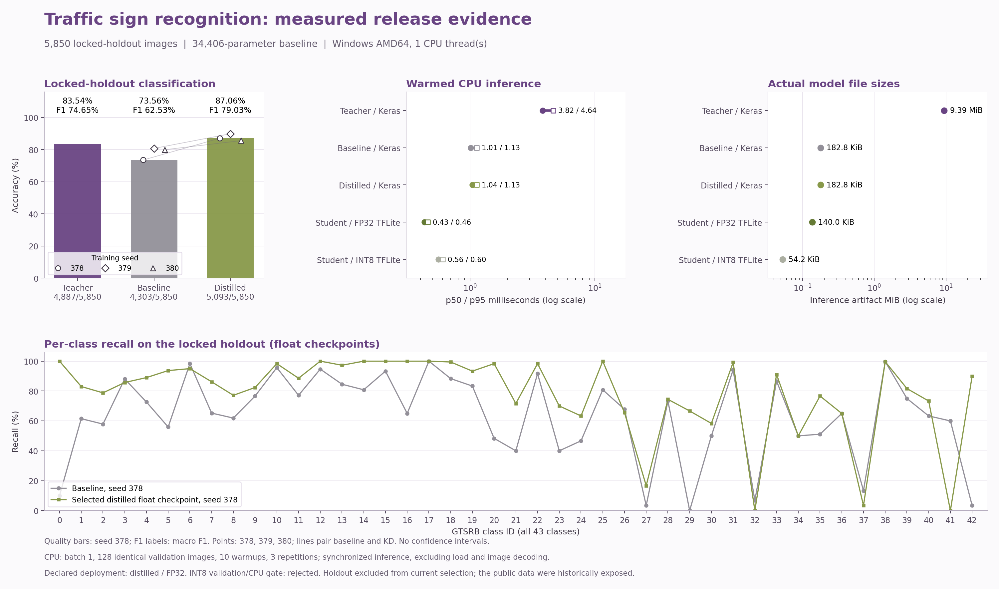

<div align="right">
  <strong>English</strong> | <a href="./README.ko.md">한국어</a>
</div>

# Knowledge Distillation for Traffic Sign Recognition

Given a cropped traffic-sign image, the model predicts which sign category it belongs to. The project asks whether a small model can learn from a larger model while retaining useful recognition quality and reducing the memory and CPU time needed to run it. It classifies an image already containing a sign; it does not locate signs in a full road scene.

A TensorFlow model-compression project for GTSRB's 43 traffic-sign classes. A MobileNetV2 teacher guides a compact CNN with **34,406 parameters**. Matched supervised baselines, a complete nine-recipe study and pure-soft controls distinguish measured training effects from deployment decisions.

**Original development period: February-April 2026.** Later engineering improvements retain this period and add controlled experiments, CPU deployment measurements and reproducible saved-model evaluation.

[Deployment and project outcome](./docs/deployment.md) | [Complete nine-recipe study](./docs/full-grid.md) | [Why students outperform the teacher](./docs/teacher-student-analysis.md) | [Architecture](./docs/architecture.md) | [Historical notebook](./notebooks/knowledge_distillation_gtsrb.ipynb)

## Understanding the experiment

| Term used in the results | Meaning here |
| --- | --- |
| Teacher, student and distillation | The larger teacher supplies probabilities for the sign classes. The smaller student learns from that distribution rather than merely copying the teacher's single predicted class. |
| Matched supervised baseline | The same small student architecture learns from the correct labels without the teacher's guidance. Shared starting conditions make it a more useful comparison for the effect of the training procedure. |
| Temperature and alpha | Temperature softens the teacher/student probability distributions used for distillation. Alpha sets the coefficient of the correct-label loss relative to the teacher-matching loss; it is not a measured fraction of the resulting gradient. |
| Seed and paired seeds | A seed controls pseudorandom choices such as initial weights and data order. The three seeds repeat training under different starting conditions, with baseline and distilled models matched within each seed. They are not three datasets. |
| Validation and reference evaluation | Validation guides recipe and checkpoint selection. The reference set reports the chosen models' outcomes afterward; its previously observed status and limits are retained below. |
| FP32 TFLite and INT8 | TFLite is the saved format used by the lightweight inference runtime. FP32 retains floating-point parameters; INT8 quantization reduces numerical precision to seek a smaller, faster artifact, which must be checked for quality loss. |

A physical-sign track groups photographs of the same sign; keeping a track in one split prevents those related photographs from crossing the evaluation boundary. An epoch is a pass through the training data, and a checkpoint stores model weights at a point during training.

The recipe label T5-a05 means temperature 5 with alpha 0.5; T5-a01 uses alpha 0.1. The experiment-selected recipe and the model offered for deployment are described separately so their different decisions remain visible.

**Reading the tables:** accuracy counts correct images. For each class, precision asks how often a prediction of that class is correct, and recall asks how many actual examples of that class were found. Macro F1 balances these two measures and gives every class equal weight; balanced accuracy averages class recall. A percentage-point gain is a direct subtraction of percentages. The ± sample SD describes variability across training seeds, not a confidence interval. CPU p50 is median latency, while p95 describes the slower end of the measured requests. Parameter count, file size and runtime measure different deployment costs.

## Representative deployment: retain the released 87.06% model

The representative model remains **T5-a05, seed 378, FP32 TFLite**. This is the previously released checkpoint, without retraining or a change to its weights. The complete nine-recipe study remains intact: its validation-selected recipe is **T5-a01**. The experiment winner and the representative deployment have different roles.

| Seed-378 model, same 5,850 reference images | Correct / count | Accuracy | macro F1 | Balanced accuracy |
| --- | --- | --- | --- | --- |
| Teacher | 4,887 / 5,850 | 83.54% | 0.7465 | 0.7548 |
| Matched supervised baseline | 4,303 / 5,850 | 73.56% | 0.6253 | 0.6329 |
| **Retained deployment, T5-a05 FP32** | **5,093 / 5,850** | **87.06%** | **0.7903** | **0.7817** |
| Nine-recipe study winner, T5-a01 | 5,013 / 5,850 | 85.69% | 0.7719 | 0.7620 |

| Selection or evaluation scope | Retained T5-a05 recipe | Study-selected T5-a01 recipe |
| --- | --- | --- |
| Three-seed validation accuracy mean | 86.65% | 87.08% |
| Three-seed reference accuracy mean ± sample SD | 87.51% ± 2.18 pp | 87.81% ± 2.08 pp |
| Seed-378 reference accuracy | 87.06% | 85.69% |

The study selects a recipe by mean validation accuracy, with seed 378 fixed beforehand. Its 0.30 pp higher mean reference accuracy does not establish a reliable deployment improvement, while the fixed seed-378 checkpoint scores 1.37 pp lower. Retaining the prior release prioritizes continuity and its observed reference performance. This is an explicit, later deployment decision informed by already observed outcomes; it does not rewrite the study selection or create an untouched benchmark. The policy is recorded in [`reports/deployment/deployment-policy.json`](./reports/deployment/deployment-policy.json).


## Overall result and teacher/student conclusion

The retained student improves reference accuracy by **13.50 pp** over the same-seed supervised baseline and by **3.52 pp** over the teacher. Across three seeds, T5-a05 has a descriptive paired baseline gain of **+9.43 ± 3.93 pp**. Its **34,406 parameters** are approximately **98.5% fewer** than the teacher's 2,313,067. In the earlier matched CPU benchmark, Keras p50 falls from **3.823 ms** for the teacher to **1.040 ms** for this student; the retained FP32 TFLite artifact measures **0.429 ms p50**, **0.456 ms p95**, and **140.0 KiB**. These are one-host measurements, not timing guarantees for another device.

The retained student corrects **473** teacher errors but introduces **267** errors on images the teacher classified correctly, for **206** additional correct predictions. Pure-soft students also exceed the teacher in all three seeds, so adding ground-truth CE to the student's objective cannot be the sole explanation. Distillation fits a probability distribution rather than copying the teacher's argmax; different architecture, full student adaptation, BN policies and optimization paths can produce different decisions. Their individual causal contributions have not been isolated. Both the teacher and mixed students use training labels. [Read the saved-prediction analysis and controls](./docs/teacher-student-analysis.md).

The project demonstrates matched experiment design, model compression, error analysis, CPU benchmarking and artifact verification. **INT8 was rejected** because both studied exports lost substantial validation accuracy and failed the measured speedup gate. The original nine-condition notebook, both controlled studies, failed conversions and their frozen evidence remain available.


All three grid seeds participate in development selection. Reference outcomes were already public, and the official test was historically used for selection. Results support this bounded traffic-sign classification comparison; they do not establish production road-scene reliability.

## Run the representative saved model

Windows PowerShell:

```powershell
.\launch-kd.bat doctor
.\launch-kd.bat download --manifest reports/artifact-download.json --output artifacts/runtime
.\launch-kd.bat download --manifest reports/artifact-download.json --output artifacts/runtime --verify-only
.\launch-kd.bat fetch-data
.\launch-kd.bat evaluate --model artifacts/runtime/models/student-fp32.tflite --manifest reports/split-manifest.json --data .local/data/gtsrb-v1 --split locked_holdout --freeze reports/evaluation-freeze.json --output .local/reproduced-representative-student
```

Linux:

```bash
bash launch-kd.sh doctor
bash launch-kd.sh download --manifest reports/artifact-download.json --output artifacts/runtime
bash launch-kd.sh download --manifest reports/artifact-download.json --output artifacts/runtime --verify-only
bash launch-kd.sh fetch-data
bash launch-kd.sh evaluate --model artifacts/runtime/models/student-fp32.tflite --manifest reports/split-manifest.json --data .local/data/gtsrb-v1 --split locked_holdout --freeze reports/evaluation-freeze.json --output .local/reproduced-representative-student
```

The [representative model bundle](https://park-dongmyung.com/downloads/knowledge-distillation-models-v2.zip) is **10.83 MiB (11,353,209 bytes)** and installs under `artifacts/runtime/models/`. Its original frozen descriptor and model hashes are retained. Saved-model CPU evaluation needs no Docker, GPU or API key. First setup and downloads need internet access; use a writable Windows or Linux x86-64 source folder.

The separate [nine-recipe model bundle](https://park-dongmyung.com/downloads/knowledge-distillation-full-grid-models.zip) and [starting-evidence bundle](https://park-dongmyung.com/downloads/knowledge-distillation-full-grid-base-evidence.zip) preserve all study checkpoints and the T5-a01 export. Use the explicit descriptor and commands in the [full-grid guide](./docs/full-grid.md) to install or reproduce that experiment. Download ZIPs do not silently replace the retained deployment with the study winner.

<details>
<summary>Preserved four-candidate study and historical notebook results</summary>

The following measurements, commands and environment checks belong to the earlier study. They do not claim a completed new-model replay for this extension. The original notebook's nine-condition results remain historical evidence.

### Results and evidence

The seed-378 checkpoints were frozen before evaluation on the same **5,850-image** locked holdout. All paired outcomes and verification evidence are in the [measured results report](./docs/results.md).

| Measured protocol result | Teacher | Matched baseline | Fixed distilled candidate |
| --- | ---: | ---: | ---: |
| Locked-holdout accuracy, correct / evaluated | 83.54%, 4,887 / 5,850 | 73.56%, 4,303 / 5,850 | 87.06%, 5,093 / 5,850 |
| Locked-holdout macro F1 | 0.7465 | 0.6253 | 0.7903 |
| Three-seed accuracy mean ± sample SD | N/A | 78.08% ± 3.94 pp | 87.51% ± 2.18 pp |
| Three-seed paired gain mean ± sample SD | N/A | Reference | +9.43 ± 3.93 pp |
| CPU batch-one p50 / p95 | 3.823 / 4.641 ms | 1.008 / 1.128 ms | 1.040 / 1.130 ms |
| Standard Keras inference artifact size | 9.39 MiB (9,843,117 bytes) | 182.8 KiB (187,164 bytes) | 182.8 KiB (187,164 bytes) |
| Parameters | 2,313,067 | 34,406 | 34,406 |

Means and sample standard deviations describe seeds 378, 379 and 380; they are not confidence intervals. CPU entries above measure matched Keras calls on validation images and are separate from TFLite deployment costs.

CPU measurement: 11th Gen Intel(R) Core(TM) i7-11800H @ 2.30GHz (Microsoft Windows 11 Pro), 1 thread(s), 128 matched images, 10 warmup calls and 3 repetitions. These timings do not guarantee latency on another device.

**Validation selection:** `T5-a05`, mean paired accuracy gain +9.16 pp, 3/3 positive pairs, declared gate passed. The holdout gain is reported separately above and does not reopen selection.

**Release decision:** seed-378 distilled, **FP32 TFLite**. INT8 was rejected with validation accuracy loss +61.863 pp and measured CPU p50 speed ratio 0.771x.
Failed criteria: validation accuracy loss, CPU p50 speedup.
The selected deployment artifact records **87.06% (5,093/5,850)** locked-holdout accuracy, **0.7903** macro F1, **0.429 / 0.456 ms** CPU p50 / p95 and **140.0 KiB (143,316 bytes)** size.
Final outcomes do not reselect the seed, checkpoint or quantization format.



#### Historical development results

| Historical measurement | Recorded value |
| --- | ---: |
| Teacher best selected-epoch accuracy | 88.37% |
| Compact baseline best selected-epoch accuracy | 54.61% |
| Best distilled selected-epoch accuracy | 80.97% |
| Student parameters / teacher parameters | 34,406 / 2,313,067 |
| Best historical setting | `temperature=10`, `alpha=0.3` |

These values come from the original single-seed, nine-condition notebook. Its official GTSRB test split was used for checkpoint and hyperparameter selection. They are historical development results, not untouched-test scores. The baseline's final in-memory model scored 54.12%, whereas the table reports its best history epoch, 54.61%. Historical `model.predict()` timing includes framework overhead and did not measure a teacher-to-student deployment speedup. Parameter reduction of approximately 67.2 times is not a measured speedup.

The new split and selection procedure differ from the historical experiment. Old and new percentages must not be treated as a controlled before/after comparison on the same untouched evaluation population.

### What the improved implementation demonstrates

1. **Evaluation by physical sign.** Class-stratified train, validation and locked-holdout sets keep every traffic-sign track in one split. Relative paths, class labels, track IDs, image bytes and SHA-256 hashes bind the exact inventory. Official-test inference is a separate audit after freezing.
2. **Matched Baseline/KD controls.** Both students share the 34,406-parameter architecture, initial weights within each seed, deterministic data order, augmentation, class weights and maximum training budget. Seeds 378, 379 and 380 measure paired variation. The deployment seed is declared as 378 before final evaluation.
3. **Correct teacher adaptation.** `[0,1]` RGB inputs are augmented and rescaled inside the teacher to MobileNetV2's `[-1,1]` input range. Head training precedes low-learning-rate fine-tuning with frozen batch normalization. The teacher's weights and saved artifact are checked for immutability during distillation.
4. **Bounded, testable distillation.** Four declared KD recipes use class-weighted hard-label CE plus unweighted Teacher-to-Student KL with temperature-squared compensation. Validation records real, unweighted CE. Best plain `.keras` checkpoints are saved and reloaded. A 0.2 percentage-point validation improvement gate and three-seed confirmation stop ineffective candidates.
5. **Measured deployment tradeoffs.** Standard `.keras` models support inference without the training wrapper. FP32 TFLite conversion and full INT8 quantization are evaluated separately. INT8 calibration uses training records only. CPU benchmarks compare the same images, thread policy and warmed invocation path, reporting latency, throughput and file size; validation controls quantization acceptance.
6. **Portable, auditable delivery.** Isolated CPU launchers, pinned dependencies, source snapshots, exact artifact inventories and SHA-256 checks support saved-model verification without retraining. Correctness tests exercise loss gradients, immutable teachers, real optimizer updates, split isolation, checkpoint reloads and tampering rejection.

These are implemented capabilities. Completed training, export and environment checks are separately identified in the release evidence rather than inferred from the presence of code.

### Run without retraining

If you use a source ZIP from the portfolio project page, extract it to a writable folder and run the same commands.

The default local runtime uses CPU. Docker, a GPU and an API key are unnecessary for public saved-model inference. First setup and downloads need internet access. Use a writable source folder on supported Windows or Linux x86-64 with Python 3.12; the launcher can obtain the pinned Python runtime when it is missing.

Windows PowerShell:

```powershell
.\launch-kd.bat doctor
.\launch-kd.bat download --manifest reports/artifact-download.json --output artifacts/runtime
.\launch-kd.bat download --manifest reports/artifact-download.json --output artifacts/runtime --verify-only
.\launch-kd.bat fetch-data
.\launch-kd.bat fetch-data --verify-only
.\launch-kd.bat predict --model artifacts/runtime/models/student-fp32.tflite --image .local/data/gtsrb-v1/Train/20/00020_00000_00000.png
```

Linux:

```bash
bash launch-kd.sh doctor
bash launch-kd.sh download --manifest reports/artifact-download.json --output artifacts/runtime
bash launch-kd.sh download --manifest reports/artifact-download.json --output artifacts/runtime --verify-only
bash launch-kd.sh fetch-data
bash launch-kd.sh fetch-data --verify-only
bash launch-kd.sh predict --model artifacts/runtime/models/student-fp32.tflite --image .local/data/gtsrb-v1/Train/20/00020_00000_00000.png
```

The example image is a training-collection input for checking the inference path, not a quality benchmark. The model descriptor extracts checkpoints under `artifacts/runtime/models/`; the published inventory identifies the exact filenames. The model bundle was downloaded in full without authentication from the [verified endpoint](https://park-dongmyung.com/downloads/knowledge-distillation-models-v2.zip) and matched its SHA-256 and byte count (10.83 MiB (11,353,209 bytes)). `reports/artifact-download.json` installs its exact declared inventory.

#### Repeat the frozen evaluation

Use the published `reports/split-manifest.json` and pre-evaluation freeze. Keep the original freeze when repeating a released model's evaluation.

```powershell
.\launch-kd.bat evaluate --model artifacts/runtime/models/student-fp32.tflite --manifest reports/split-manifest.json --data .local/data/gtsrb-v1 --split locked_holdout --freeze reports/evaluation-freeze.json --output .local/reproduced-student
```

On Linux, replace `.\launch-kd.bat` with `bash launch-kd.sh`. Use a new output directory for each run. Published manifests and freeze files identify the exact model, denominator, configuration and source. Evaluation produces aggregate metrics, an all-class confusion matrix and image-ID predictions.

#### Run correctness tests

After `doctor` has prepared `.venv`:

```powershell
$env:CUDA_VISIBLE_DEVICES = "-1"
.venv\Scripts\python.exe -m unittest discover -s tests -v
```

```bash
CUDA_VISIBLE_DEVICES=-1 .venv/bin/python -m unittest discover -s tests -v
```

**Runtime and saved-model verification:** Windows, Python 3.12.15: 62/63 correctness tests passed, 1 skipped, 0 failures. Full 5,850-image saved-model holdout reruns matched reference accuracy and macro F1 (`baseline` 4,303/5,850, `distilled` 5,093/5,850, `fp32` 5,093/5,850). Linux (WSL2), Python 3.12.15: 63/63 correctness tests passed, 0 skipped, 0 failures. Full 5,850-image saved-model holdout reruns matched reference accuracy and macro F1 (`baseline` 4,303/5,850, `distilled` 5,093/5,850, `fp32` 5,093/5,850). The operating-system checks use the same physical computer and are not an independent external review. Synthetic correctness checks and full saved-model evaluation are reported as separate scopes.

### Training and reproduction limits

Full project training runs only in a GPU-enabled Kaggle kernel. The [declared plan](./configs/experiment-plan.json) bounds teacher variants and KD candidates, separates pilot selection from paired confirmation, and freezes model, source and configuration hashes before final inference. See the [training guide](./docs/training.md) for commands and saved outputs. The original notebook is historical evidence rather than the current training entry point.

The locked holdout is excluded from training and selection in the new experiment, but those images belonged to the historical notebook's full training collection. New models start from fresh ImageNet teacher weights and fresh student initialization. This does not establish that the public data were unseen by every historical or upstream pretrained model. The official test was historically exposed and remains labelled as an audit.

Same source, model and data hashes support repeated saved-model evaluation. Hardware, drivers and floating-point implementations can affect timing and small numerical differences. Checks in another operating-system environment on the same computer are environment verification, not an independent external review. GTSRB classification is a bounded research task and does not demonstrate production road-scene perception.

### Repository guide

| Location | Purpose |
| --- | --- |
| `knowledge_distillation/` | Track splits, models, training, evaluation, export and CPU inference |
| `configs/experiment-plan.json` | Declared search budget, paired seeds and stopping policy |
| `scripts/` and `launch-kd.*` | Isolated runtime setup and verified downloads |
| `tests/` | Synthetic correctness, integrity and portability checks |
| `reports/` | Published results, manifests, freezes and verification evidence |
| `docs/` | English documentation with corresponding Korean versions |
| `notebooks/knowledge_distillation_gtsrb.ipynb` | Labelled historical experiment |

Method references: [GTSRB dataset](https://benchmark.ini.rub.de/gtsrb_dataset.html), [knowledge distillation](https://arxiv.org/abs/1503.02531), [MobileNetV2 preprocessing](https://keras.io/api/applications/mobilenet/mobilenet_models/), [Keras transfer learning](https://keras.io/guides/transfer_learning/).

</details>
