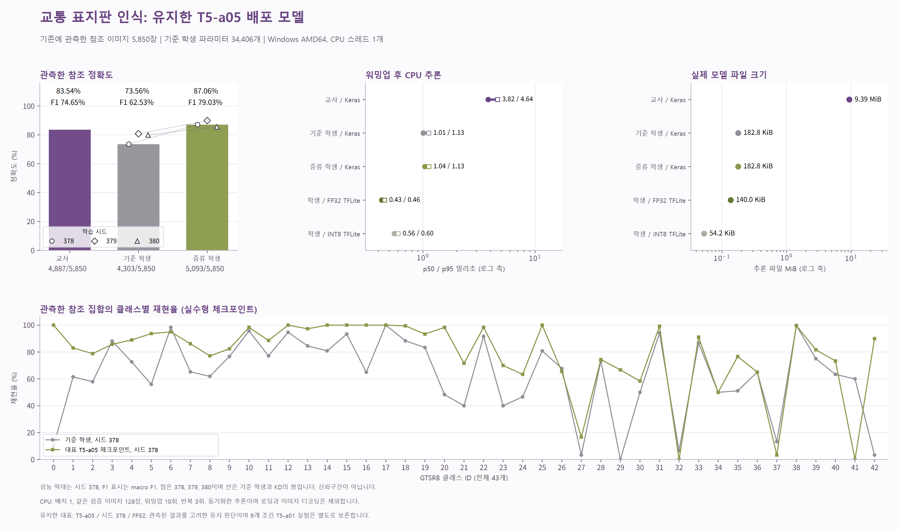

<div align="right"><a href="./deployment.md">English</a> | <strong>한국어</strong></div>

# 대표 배포와 프로젝트 전체 결과

대표 배포는 기존 **T5-a05, 시드 378, FP32 TFLite** 체크포인트를 유지합니다. 전체 9개 조합 연구의 검증 선택은 **T5-a01** 그대로입니다. 기존 체크포인트, 선택 보고서, 평가 동결 기록, 저장 예측과 모델 번들을 변경하지 않았으며 [배포 정책](../reports/deployment/deployment-policy.json)에 후속 유지 결정을 명시합니다.

## 기존 배포를 유지하는 이유

| 비교 범위 | 유지한 T5-a05 | 연구 선택 T5-a01 |
| --- | --- | --- |
| 온도 / 정답 손실 혼합 계수 | 5 / 0.5 | 5 / 0.1 |
| 세 시드의 검증 정확도 평균 | 86.65% | 87.08% |
| 세 시드의 참고 정확도 평균 ± 표본 SD | 87.51% ± 2.18%p | 87.81% ± 2.08%p |
| 시드 378의 정답 / 평가 | 5,093 / 5,850 | 5,013 / 5,850 |
| 시드 378의 참고 정확도 | 87.06% | 85.69% |
| 시드 378의 macro F1 | 0.7903 | 0.7719 |
| 시드 378의 balanced accuracy | 0.7817 | 0.7620 |

전체 조합 연구는 조건을 충족한 설정 중 세 시드의 검증 정확도 평균이 가장 높은 **학습 설정**을 선택합니다. 연구의 배포 및 평가 시드는 추론 전에 378로 고정했으며 참고 결과를 보고 가장 높은 개별 체크포인트를 고르지 않았습니다. 따라서 T5-a01을 선택한 실험 절차는 일관되지만 기존 배포 모델을 반드시 교체해야 한다는 결론은 아닙니다.

T5-a01의 참고 정확도 평균은 개발 시드 3개에서 0.30%p 높습니다. 이 작은 기술적 차이로 확실한 배포 개선을 입증하지는 않습니다. 고정된 시드 378에서는 기존보다 정답이 80개 적으며 정확도가 1.37%p 낮습니다. 기존 모델 유지는 배포의 연속성과 확인된 참고 성능을 고려합니다. 이미 관찰한 결과를 고려한 배포 결정이며 새로운 검증 전용 선택이나 독립 확인 결과로 표현하지 않습니다. 연구 선택, 전체 9개 설정과 실패한 변환도 그대로 보고합니다.

## 대표 모델의 성능과 실행 비용

아래 분류 지표는 동일한 이미지 5,850장을 사용합니다. CPU 비용은 **기존 T5-a05 공개 모델의 벤치마크**이며 새 T5-a01 측정값으로 대신하지 않습니다.

| 지표 | 교사 | 시드 378 독립 학습 기준 | 시드 378 대표 증류 |
| --- | --- | --- | --- |
| 정답 / 평가 | 4,887 / 5,850 | 4,303 / 5,850 | 5,093 / 5,850 |
| 정확도 | 83.54% | 73.56% | 87.06% |
| macro F1 | 0.7465 | 0.6253 | 0.7903 |
| 파라미터 | 2,313,067 | 34,406 | 34,406 |
| 일반 Keras 파일 | 9,843,117바이트 | 187,164바이트 | 187,164바이트 |
| Keras CPU p50 / p95 | 3.823 / 4.641ms | 1.008 / 1.128ms | 1.040 / 1.130ms |

학생은 교사보다 파라미터가 약 **98.5%**, 일반 Keras 파일 크기가 약 **98.1%** 작습니다. 같은 호스트에서 Keras p50의 비율은 약 **3.68배**입니다. 대표 학생의 별도 FP32 TFLite는 **143,316바이트, 140.0KiB**, **p50 0.429ms**, **p95 0.456ms**입니다. 구조 압축, 파일 크기 감소와 실측 속도 향상은 서로 다른 지표입니다.

기존 벤치마크는 Windows의 Intel Core i7-11800H CPU, 스레드 1개, 동일 검증 이미지 128장, 배치 1, 워밍업 10회와 반복 3회입니다. 프레임워크 import, 모델 로딩과 이미지 디코딩 시간은 추론 지연에서 제외합니다. 다른 기기에서 같은 속도를 보장하지 않습니다. 상세 기록은 [`reports/release-summary.json`](../reports/release-summary.json)과 [앞선 결과 안내](./results.ko.md)에 있습니다.

T5-a05의 세 시드 참고 정확도는 **87.51% ± 2.18%p**, 대응한 독립 학습 기준은 **78.08% ± 3.94%p**입니다. 대응 차이는 평균 **+9.43%p ± 3.93%p**입니다. 평균과 표본 표준편차이며 신뢰구간이나 교사 시드의 변동이 아닙니다.



## 학생이 교사보다 높은 성능을 보인 이유

대표 학생은 **교사의 오답 473개를 수정하고 교사가 맞힌 267개를 틀렸습니다.** 정답이 206개 증가하며 정확도가 **3.52%p** 높아졌습니다. 연구 선택 T5-a01은 별도로 465개를 수정하고 339개를 틀려 정답이 126개 증가했습니다. 두 결과는 실제 체크포인트에 맞춰 구분합니다.

증류는 교사의 최댓값 클래스 결정을 똑같이 재현하도록 강제하는 대신 온도로 완화한 확률 분포를 최적화합니다. 학생은 다른 결정 경계를 학습할 수 있습니다. 순수 증류 T5-a00 학생도 **세 시드 모두에서 교사를 넘었으므로** 학생의 정답 CE 추가만으로 이 현상을 설명할 수 없습니다. 교사와 혼합 증류 학생 모두 정답으로 학습하며 순수 증류 대조의 검증 체크포인트 선택에도 정답 레이블이 사용됩니다.

확인된 절차 차이는 사전학습 교사의 부분 미세 조정과 고정 BN, 소형 학생 전체의 학습 및 갱신되는 BN, 드롭아웃, 최대 학습 예산, 최적화 이력과 선택 에포크입니다. 서로 다른 판단을 만드는 설명 후보이지만 각 요인의 인과 기여는 입증하지 않았습니다. 근거가 뒷받침하는 결론은 해당 참고 평가에서 학생이 교사보다 높은 성능을 기록했다는 것입니다. 압축 자체가 정확도를 높였거나 학생이 항상 교사보다 낫다는 결론은 아닙니다. [상세 분석](./teacher-student-analysis.ko.md)에 예측 오류, 트랙 재표집, 클래스별 결과와 대응 대조를 보존합니다.

## FP32와 배포에서 제외한 INT8

FP32는 32비트 실수를 사용합니다. INT8 TFLite는 같은 학습된 학생의 가중치와 중간 계산값을 8비트 정수 표현으로 변환한 양자화 파일이며 새로운 구조나 별도로 학습한 모델이 아닙니다. 저장 공간을 줄이고 지원되는 하드웨어에서 실행을 빠르게 할 수 있지만 정확도와 속도는 직접 측정해야 합니다. [Google 공식 양자화 명세](https://developers.google.com/edge/litert/conversion/tensorflow/quantization/quantization_spec)를 참고할 수 있습니다.

| 기록한 공개 모델 | FP32 바이트 | INT8 바이트 | 검증 정확도 감소, FP32 − INT8 | FP32 대비 INT8 CPU p50 속도 비율 | 결정 |
| --- | --- | --- | --- | --- | --- |
| 대표 T5-a05 | 143,316 | 55,472 | 61.863%p | 0.771배 | INT8 제외, FP32 유지 |
| 연구 선택 T5-a01 | 143,316 | 55,472 | 46.410%p | 0.786배 | INT8 제외, 연구용 FP32 변환 보존 |

두 파일 모두 약 61% 작아졌지만 정확도 감소 최대 1.0%p와 CPU 속도 향상 최소 1.05배 기준을 충족하지 못했습니다. 보정에는 학습 이미지만 사용합니다. 변환 과정에서 정확도가 급락한 내부 원인은 확정하지 않았습니다. 앞선 [INT8 진단](../reports/int8-validation-diagnostic.json)은 점검한 실행기의 양자화 경로가 원인인 경우를 배제하고 범위 처리의 가능성을 기록했지만 변환기의 결함을 입증하지는 않습니다. INT8 파일은 배포 권장 모델이 아닌 재현 가능한 실패 실험으로 제공합니다.

대표 그래프는 기존 측정 요약과 배포 유지 정책을 사용해 다시 생성할 수 있습니다.

```bash
python scripts/plot_results.py --summary reports/release-summary.json --deployment-policy reports/deployment/deployment-policy.json --output .local/representative-figures
```

## 모델의 역할에 맞춰 재현하기

[대표 모델 ZIP](https://park-dongmyung.com/downloads/knowledge-distillation-models-v2.zip)과 기존 [`reports/artifact-download.json`](../reports/artifact-download.json)은 87.06% 모델 및 원래 SHA-256 연결을 유지합니다. 이 체크포인트에는 기존 평가 동결 기록을 사용합니다.

```powershell
.\launch-kd.bat doctor
.\launch-kd.bat download --manifest reports/artifact-download.json --output artifacts/runtime
.\launch-kd.bat download --manifest reports/artifact-download.json --output artifacts/runtime --verify-only
.\launch-kd.bat fetch-data
.\launch-kd.bat evaluate --model artifacts/runtime/models/student-fp32.tflite --manifest reports/split-manifest.json --data .local/data/gtsrb-v1 --split locked_holdout --freeze reports/evaluation-freeze.json --output .local/reproduced-representative-student
```

Linux에서는 `.\launch-kd.bat`를 `bash launch-kd.sh`로 바꿉니다. 새로운 출력 폴더를 사용하며 저장 모델의 CPU 재현에는 Docker, GPU와 API 키가 필요하지 않습니다.

[9개 조합 모델 ZIP](https://park-dongmyung.com/downloads/knowledge-distillation-full-grid-models.zip), [초기 실험 근거 ZIP](https://park-dongmyung.com/downloads/knowledge-distillation-full-grid-base-evidence.zip), [`reports/full-grid/artifact-download.json`](../reports/full-grid/artifact-download.json)과 [`reports/full-grid/evaluation-freeze.json`](../reports/full-grid/evaluation-freeze.json)은 변경하지 않습니다. `artifacts/full-grid/`에서 T5-a01, 나머지 설정과 순수 증류 대조를 포함한 연구를 재현합니다. [전체 조합 안내](./full-grid.ko.md)에 모든 체크포인트 검증 명령과 Kaggle 재학습 절차를 따로 제공합니다.

## 프로젝트가 보여주는 역량

- **통제된 실험:** 전체 9개 설정과 시드 3개의 증류 비교, 동일 조건의 독립 학습 기준, 순수 증류 대조와 최초 실험 근거 보존
- **실측 기반 경량화:** 학생 목적 함수가 달라도 같은 추론 구조 유지, 파라미터와 파일 크기 산출, CPU 지연 측정과 INT8 제외 결정
- **결과 해석:** macro F1, balanced accuracy, 클래스 재현율, 대응 예측 오류와 인과 설명의 한계 구분
- **검증 가능한 제공:** 고정된 CPU 환경, 트랙 단위로 분리한 데이터 명세, 모델과 소스 체크섬, 동결된 연결, 공개 다운로드와 저장 모델 재현 명령
- **배포 판단:** 확장 실험이 교체 이점을 입증하지 못할 때 기존 공개 모델을 유지하고 연구 결과는 보존

프로젝트의 가치는 검증 가능한 모델 경량화 절차에 있습니다. GTSRB 최고 성능을 주장하지 않습니다. 최초 개발 기간은 **2026년 2월부터 4월**입니다. 참고 결과는 이미 관찰됐고 공식 테스트는 과거 모델 선택에 사용됐습니다. 같은 컴퓨터의 Windows와 Linux 점검은 환경 검증이며 독립 외부 검증은 아닙니다. 잘라낸 표지판 43개 클래스의 분류만으로 실제 도로 인지 시스템을 입증하지 않습니다.
