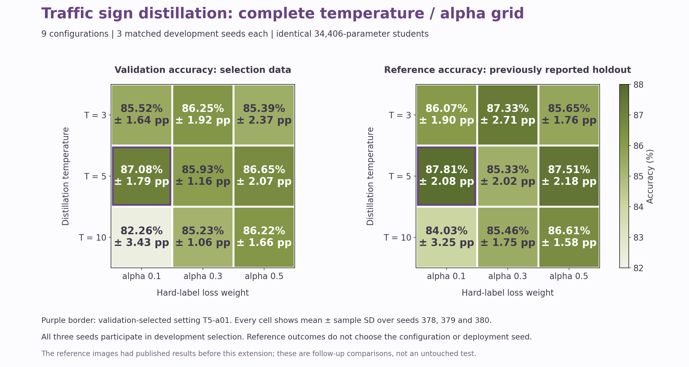

<div align="right"><a href="./full-grid.md">English</a> | <strong>한국어</strong></div>

# 9개 조합을 세 시드에서 비교한 확장 실험

온도 3, 5, 10과 정답 손실 혼합 계수 alpha 0.1, 0.3, 0.5의 전체 조합을 시드 378, 379, 380에서 학습했습니다. 27개 증류 결과 중 기존에 완료한 6개를 재사용하고 21개를 추가했습니다. 동일 교사, 기준 모델 3개와 시드별 초기 가중치는 체크섬으로 검증해 재사용했습니다. 별도의 순수 증류 대조 실험 `T5-a00` 3개는 선택 후보에 포함하지 않습니다.

목적 함수는 `alpha * weighted_CE + (1-alpha) * T^2 * KL(teacher || student)`입니다. alpha는 정답 손실의 혼합 계수입니다. 클래스 가중치와 온도의 제곱이 각 항의 크기에 영향을 주므로 alpha 0.5를 실제 총손실이나 기울기의 50%로 해석하지 않습니다.

최초 개발 기간은 **2026년 2월부터 4월**입니다. 최초 노트북, 앞선 4개 후보 연구의 계획, 결과와 동결 기록은 그대로 보존합니다. 새로운 실행기는 `scripts/full_grid_study.py`이며 기존 `knowledge_distillation train` 명령의 4개 후보 절차를 변경하지 않습니다.

## 모델 선택과 평가의 의미

검증 정확도 평균이 기준 모델보다 최소 **0.2%p** 높고 세 시드 중 최소 **2개**에서 향상한 설정만 선택 대상입니다. 평균 검증 정확도가 높은 설정, 평균 검증 CE가 낮은 설정, 선언된 후보 순서로 결정합니다. 선택은 **T5-a01**, 평균 검증 향상은 **+9.58 %p**입니다. 배포 시드 **378**은 고정합니다.

세 시드는 모두 개발 단계의 모델 선택 반복입니다. 별도의 독립 확인 시드로 해석하지 않습니다. 아래 참고 평가 집합 5,850장은 앞선 연구에서 결과가 이미 공개됐습니다. 확장 실험의 학습과 선택에는 이 결과를 입력하지 않았지만, 사람이 과거 결과를 확인하지 않은 평가라고 주장할 수 없습니다. 새로운 미사용 최종 평가로 표현하지 않습니다.

## 전체 조합 결과

| 설정 | 온도 | alpha | 검증 평균 ± 표본 SD | 참고 평가 평균 ± 표본 SD | 검증 향상한 시드 |
| --- | --- | --- | --- | --- | --- |
| T3-a01 | 3 | 0.1 | 85.52% ± 1.64 %p | 86.07% ± 1.90 %p | 3/3 |
| T3-a03 | 3 | 0.3 | 86.25% ± 1.92 %p | 87.33% ± 2.71 %p | 3/3 |
| T3-a05 | 3 | 0.5 | 85.39% ± 2.37 %p | 85.65% ± 1.76 %p | 3/3 |
| **T5-a01** | 5 | 0.1 | 87.08% ± 1.79 %p | 87.81% ± 2.08 %p | 3/3 |
| T5-a03 | 5 | 0.3 | 85.93% ± 1.16 %p | 85.33% ± 2.02 %p | 3/3 |
| T5-a05 | 5 | 0.5 | 86.65% ± 2.07 %p | 87.51% ± 2.18 %p | 3/3 |
| T10-a01 | 10 | 0.1 | 82.26% ± 3.43 %p | 84.03% ± 3.25 %p | 3/3 |
| T10-a03 | 10 | 0.3 | 85.23% ± 1.06 %p | 85.46% ± 1.75 %p | 3/3 |
| T10-a05 | 10 | 0.5 | 86.22% ± 1.66 %p | 86.61% ± 1.58 %p | 3/3 |

굵게 표시한 설정은 검증으로 선택했습니다. 각 값은 시드 378, 379, 380의 평균과 표본 표준편차입니다. 표준편차는 신뢰구간이 아니며 교사 학습 시드의 변동도 측정하지 않습니다.



## 선택 모델과 대응 차이


| 모델 | 정답 / 평가 | 정확도 | macro F1 | Balanced accuracy |
| --- | --- | --- | --- | --- |
| 교사 | 4,887 / 5,850 | 83.54% | 0.7465 | 0.7548 |
| 독립 학습 기준 | 4,303 / 5,850 | 73.56% | 0.6253 | 0.6329 |
| 선택 학생, Keras | 5,013 / 5,850 | 85.69% | 0.7719 | 0.7620 |
| 배포 학생, FP32 | 5,013 / 5,850 | 85.69% | 0.7719 | 0.7620 |

| 시드 | 기준 정확도 | 선택 설정 정확도 | 대응 차이 |
| --- | --- | --- | --- |
| 378 | 73.56% | 85.69% | +12.14 %p |
| 379 | 80.75% | 89.85% | +9.09 %p |
| 380 | 79.93% | 87.88% | +7.95 %p |

선택한 설정과 기준 모델의 참고 평가 차이는 평균 **+9.73%p**, 표본 표준편차 **2.16%p**입니다. 이 수치로 다른 설정이나 시드를 재선택하지 않습니다. 학생 구조는 34,406개 파라미터이며 교사는 2,313,067개입니다.

## CPU 실행 비용과 양자화 결정

| 추론 파일 | p50 (ms) | p95 (ms) | 파일 크기 |
| --- | --- | --- | --- |
| 교사 Keras | 3.814 | 4.451 | 9.39 MiB (9,843,117 bytes) |
| 기준 Keras | 0.990 | 1.149 | 182.8 KiB (187,164 bytes) |
| 선택 학생 Keras | 1.010 | 1.170 | 182.8 KiB (187,164 bytes) |
| FP32 TFLite | 0.430 | 0.574 | 140.0 KiB (143,316 bytes) |
| INT8 TFLite | 0.547 | 0.591 | 54.2 KiB (55,472 bytes) |

CPU 환경은 `Windows`의 `AMD64`, Python `3.12.15`입니다. 동일한 검증 이미지 128장, 배치 1, CPU 스레드 1개, 워밍업 10회와 반복 3회를 사용했습니다. Keras와 TFLite 비용은 별도 파일 형식의 실제 측정값입니다. 파라미터 수나 파일 크기의 감소를 속도 향상으로 대체하지 않습니다.

배포 형식은 **FP32**입니다. INT8의 검증 정확도 감소는 **+46.410%p**, FP32 대비 CPU p50 속도 비율은 **0.786배**입니다. 허용 정확도 감소 **1.0%p**, 최소 속도 비율 **1.05배**, 더 작은 파일 조건을 함께 적용했습니다. INT8 보정에는 학습 이미지만 사용했고 양자화 선택은 검증 결과로만 결정했습니다. INT8 파일은 채택 여부와 관계없이 재현용 번들에 포함됩니다.

## 공개 모델과 재현

모델 및 초기 실험 근거를 [`reports/full-grid/artifact-download.json`](../reports/full-grid/artifact-download.json)으로 설치합니다. 모델은 `artifacts/full-grid/models/`, 원본 근거 47개는 `artifacts/full-grid/original-base-run/`에 놓입니다. 로그인 없는 URL과 바이트 수 및 SHA는 명세에 기록되며, 원격 전송을 실제 확인한 결과는 별도의 검증 기록으로 구분합니다.

Windows PowerShell:

```powershell
.\launch-kd.bat doctor
.\launch-kd.bat download --manifest reports/full-grid/artifact-download.json --output artifacts/full-grid
.\launch-kd.bat download --manifest reports/full-grid/artifact-download.json --output artifacts/full-grid --verify-only
.\launch-kd.bat fetch-data
.\launch-kd.bat evaluate --model artifacts/full-grid/models/student-fp32.tflite --manifest reports/split-manifest.json --data .local/data/gtsrb-v1 --split locked_holdout --freeze reports/full-grid/evaluation-freeze.json --output .local/reproduced-full-grid-student
```

Linux:

```bash
bash launch-kd.sh doctor
bash launch-kd.sh download --manifest reports/full-grid/artifact-download.json --output artifacts/full-grid
bash launch-kd.sh download --manifest reports/full-grid/artifact-download.json --output artifacts/full-grid --verify-only
bash launch-kd.sh fetch-data
bash launch-kd.sh evaluate --model artifacts/full-grid/models/student-fp32.tflite --manifest reports/split-manifest.json --data .local/data/gtsrb-v1 --split locked_holdout --freeze reports/full-grid/evaluation-freeze.json --output .local/reproduced-full-grid-student
```


34개 학습 체크포인트와 3개 배포 별칭의 전체 평가를 저장된 참고 예측과 비교하는 명령입니다. 각 결과의 레이블과 결정, 집계 지표 및 동결된 모델과 입력 구성을 확인합니다. 신뢰도 값의 차이는 별도 관찰값으로 보고하며 모든 부동소수점 값의 동일성을 주장하지 않습니다.

Windows PowerShell:

```powershell
.venv\Scripts\python.exe scripts/verify_full_grid_release.py --descriptor reports/full-grid/artifact-download.json --artifact-root artifacts/full-grid --manifest reports/split-manifest.json --freeze reports/full-grid/evaluation-freeze.json --reference-summary reports/full-grid/release-summary.json --reference-evaluations reports/full-grid/evaluations/locked_holdout --data .local/data/gtsrb-v1 --output .local/reproduced-full-grid --threads 1 --batch-size 64
```

Linux:

```bash
.venv/bin/python scripts/verify_full_grid_release.py --descriptor reports/full-grid/artifact-download.json --artifact-root artifacts/full-grid --manifest reports/split-manifest.json --freeze reports/full-grid/evaluation-freeze.json --reference-summary reports/full-grid/release-summary.json --reference-evaluations reports/full-grid/evaluations/locked_holdout --data .local/data/gtsrb-v1 --output .local/reproduced-full-grid --threads 1 --batch-size 64
```


매번 새로운 평가 출력 경로를 사용합니다. 저장 모델의 평가에는 Docker, GPU와 API 키가 필요하지 않습니다. 학습을 다시 실행하려면 자신의 Kaggle 계정과 GPU 환경을 준비합니다.

```powershell
.venv\Scripts\python.exe -m scripts.package_full_grid_kaggle --base-descriptor reports/full-grid/base-download.json --dataset-root .local/data/gtsrb-v1 --output .local/full-grid-kaggle-package --kernel-id YOUR_ACCOUNT/YOUR_PRIVATE_SLUG
```

Linux에서는 인터프리터를 `.venv/bin/python`으로 바꿉니다. 이 명령은 제출 파일만 준비합니다. 명세를 통한 원본 근거 다운로드를 사용하므로 다른 사람의 비공개 커널에 접근할 필요가 없습니다. Kaggle 실행기는 부모의 prepare, 각 GPU의 train-worker, 모든 작업 완료 후 finalize와 freeze를 순서대로 실행합니다.

[`configs/full-grid-plan.json`](../configs/full-grid-plan.json), [`reports/full-grid/study-report.json`](../reports/full-grid/study-report.json), [`reports/full-grid/release-summary.json`](../reports/full-grid/release-summary.json)과 새 동결 기록을 함께 확인하십시오. 기존 계획과 동결은 별도 기록으로 유지합니다. 교사와 학생의 오류 및 고정 T5 대조 결과는 [분석 보고서](./teacher-student-analysis.ko.md)에 정리했습니다.

공식 GTSRB 테스트는 최초 실험에서 모델 선택에 사용됐으므로 참고 감사 결과로 구분합니다. 이 제한된 분류 실험은 실제 도로 영상 시스템이나 모든 환경의 일반화를 입증하지 않습니다.
