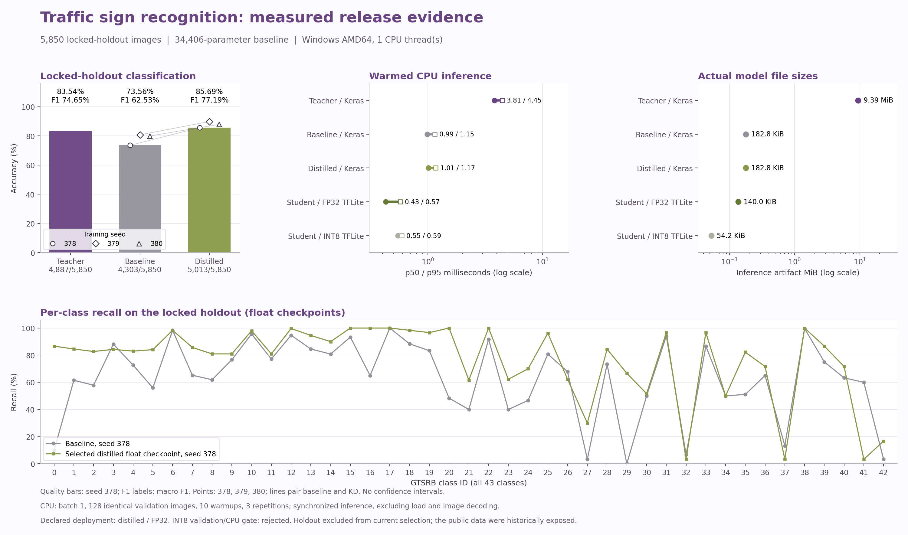

<div align="right"><strong>English</strong> | <a href="./full-grid.ko.md">한국어</a></div>

# Complete temperature/alpha grid across three development seeds

This study compares ways of teaching the same small traffic-sign classifier with a larger teacher. A **recipe** is one temperature/alpha combination: temperature controls how soft the class probabilities are during teaching, and alpha controls the coefficient of learning from the correct label. **Three seeds** means training repetitions with different pseudorandom starting values, while matching the baseline and student within each repetition.

In the objective below, CE is cross-entropy, which penalizes assigning too little probability to the correct class. KL measures disagreement between teacher and student distributions. A pure-soft control uses only the teacher-matching part in the student's objective, helping test explanations for the observed results. The teacher and model-selection process still use labels.

All nine combinations of temperature 3, 5 and 10 with hard-label loss mixing coefficient alpha 0.1, 0.3 and 0.5 were trained for seeds 378, 379 and 380. Six completed KD runs were reused and 21 were added. The exact teacher, three supervised baselines and shared initialization files were verified before reuse. Three `T5-a00` pure-soft diagnostic controls are excluded from recipe selection.

The objective is `alpha * weighted_CE + (1-alpha) * T^2 * KL(teacher || student)`. Alpha is a hard-label loss mixing coefficient. Class weights and temperature-squared scaling affect term magnitudes; alpha 0.5 does not establish 50% of the realized loss or gradient.

The original development period remains **February-April 2026**. The historical notebook, previous four-candidate plan, reports and freezes remain preserved. The extension runs through `scripts/full_grid_study.py`; the original four-candidate `knowledge_distillation train` entry point stays unchanged.

## Selection and evaluation scope

An eligible recipe needs mean validation gain of at least **0.2 percentage points** over the matched baseline and positive gains in at least **two of three** seeds. Selection ranks mean validation accuracy, then lower mean validation CE, then declared recipe order. The selected recipe is **T5-a01**, with mean validation gain **+9.58 pp**. Study evaluation seed **378** is fixed. The representative deployment separately retains the prior T5-a05 seed-378 release; see the [deployment policy](./deployment.md). This later continuity decision does not alter this study's validation selection or frozen exports.

All three seeds participate in development selection; they are not independent confirmation seeds. The 5,850 reference images already had published outcomes from the earlier study. Their outcomes do not enter this extension's training or selection, but earlier human exposure is acknowledged. This is a follow-up comparison on the same reference collection, not an untouched final benchmark.

## Full-grid results

| Recipe | T | alpha | Validation mean ± sample SD | Reference mean ± sample SD | Positive validation pairs |
| --- | --- | --- | --- | --- | --- |
| T3-a01 | 3 | 0.1 | 85.52% ± 1.64 pp | 86.07% ± 1.90 pp | 3/3 |
| T3-a03 | 3 | 0.3 | 86.25% ± 1.92 pp | 87.33% ± 2.71 pp | 3/3 |
| T3-a05 | 3 | 0.5 | 85.39% ± 2.37 pp | 85.65% ± 1.76 pp | 3/3 |
| **T5-a01** | 5 | 0.1 | 87.08% ± 1.79 pp | 87.81% ± 2.08 pp | 3/3 |
| T5-a03 | 5 | 0.3 | 85.93% ± 1.16 pp | 85.33% ± 2.02 pp | 3/3 |
| T5-a05 | 5 | 0.5 | 86.65% ± 2.07 pp | 87.51% ± 2.18 pp | 3/3 |
| T10-a01 | 10 | 0.1 | 82.26% ± 3.43 pp | 84.03% ± 3.25 pp | 3/3 |
| T10-a03 | 10 | 0.3 | 85.23% ± 1.06 pp | 85.46% ± 1.75 pp | 3/3 |
| T10-a05 | 10 | 0.5 | 86.22% ± 1.66 pp | 86.61% ± 1.58 pp | 3/3 |

The bold recipe was chosen on validation. Entries are mean and sample standard deviation over seeds 378, 379 and 380. Standard deviations are not confidence intervals and do not measure teacher-training-seed uncertainty.


## Study-selected checkpoints and paired outcomes



| Model | Correct / count | Accuracy | macro F1 | Balanced accuracy |
| --- | --- | --- | --- | --- |
| Teacher | 4,887 / 5,850 | 83.54% | 0.7465 | 0.7548 |
| Supervised baseline | 4,303 / 5,850 | 73.56% | 0.6253 | 0.6329 |
| Selected student, Keras | 5,013 / 5,850 | 85.69% | 0.7719 | 0.7620 |
| Study export, T5-a01 FP32 | 5,013 / 5,850 | 85.69% | 0.7719 | 0.7620 |

| Seed | Baseline accuracy | Selected-recipe accuracy | Paired gain |
| --- | --- | --- | --- |
| 378 | 73.56% | 85.69% | +12.14 pp |
| 379 | 80.75% | 89.85% | +9.09 pp |
| 380 | 79.93% | 87.88% | +7.95 pp |

The selected recipe's mean reference gain over the baseline is **+9.73 pp**, with sample SD **2.16 pp**. These values do not reselect a recipe or seed. Students retain 34,406 parameters; the teacher has 2,313,067.

## CPU costs and quantization decision

| Inference artifact | p50 (ms) | p95 (ms) | File size |
| --- | --- | --- | --- |
| Teacher Keras | 3.814 | 4.451 | 9.39 MiB (9,843,117 bytes) |
| Baseline Keras | 0.990 | 1.149 | 182.8 KiB (187,164 bytes) |
| Selected student Keras | 1.010 | 1.170 | 182.8 KiB (187,164 bytes) |
| FP32 TFLite | 0.430 | 0.574 | 140.0 KiB (143,316 bytes) |
| INT8 TFLite | 0.547 | 0.591 | 54.2 KiB (55,472 bytes) |

Measured host: `Windows`, `AMD64`, Python `3.12.15`. Costs use the same 128 validation images, batch one, one CPU thread, ten warmup calls and three repetitions. Keras and TFLite entries are distinct measured artifact formats. Parameter or file-size reduction is not substituted for measured speedup.

The selected format for this study's T5-a01 export is **FP32**. Its files and measurements remain study artifacts; the representative deployment uses the earlier T5-a05 FP32 file and its original benchmark. INT8 validation accuracy loss is **+46.410 pp**, with FP32-to-INT8 CPU p50 speed ratio **0.786x**. Acceptance requires at most **1.0 pp** loss, at least **1.05x** speedup and a smaller file. Calibration uses training images only; validation chooses the format. INT8 remains in the reproduction bundle whether accepted or rejected.

## Public study artifacts and reproduction

Install the models and starting evidence with [`reports/full-grid/artifact-download.json`](../reports/full-grid/artifact-download.json). Models reside under `artifacts/full-grid/models/`; all 47 base artifacts reside under `artifacts/full-grid/original-base-run/`. The descriptor declares public URLs, byte counts and SHA hashes. Actual remote transfer verification is a separate evidence scope.

Windows PowerShell:

```powershell
.\launch-kd.bat doctor
.\launch-kd.bat download --manifest reports/full-grid/artifact-download.json --output artifacts/full-grid
.\launch-kd.bat download --manifest reports/full-grid/artifact-download.json --output artifacts/full-grid --verify-only
.\launch-kd.bat fetch-data
.\launch-kd.bat evaluate --model artifacts/full-grid/models/student-fp32.tflite --manifest reports/split-manifest.json --data .local/data/gtsrb-v1 --split locked_holdout --freeze reports/full-grid/evaluation-freeze.json --output .local/reproduced-full-grid-student
```

Linux:

```bash
bash launch-kd.sh doctor
bash launch-kd.sh download --manifest reports/full-grid/artifact-download.json --output artifacts/full-grid
bash launch-kd.sh download --manifest reports/full-grid/artifact-download.json --output artifacts/full-grid --verify-only
bash launch-kd.sh fetch-data
bash launch-kd.sh evaluate --model artifacts/full-grid/models/student-fp32.tflite --manifest reports/split-manifest.json --data .local/data/gtsrb-v1 --split locked_holdout --freeze reports/full-grid/evaluation-freeze.json --output .local/reproduced-full-grid-student
```


Compare all 34 trained checkpoints and three deployment aliases against stored reference predictions with the following command. The verifier checks labels, decisions, aggregate metrics and frozen model/input bindings. Confidence differences are reported separately; bitwise equality of every floating-point value is not claimed.

Windows PowerShell:

```powershell
.venv\Scripts\python.exe scripts/verify_full_grid_release.py --descriptor reports/full-grid/artifact-download.json --artifact-root artifacts/full-grid --manifest reports/split-manifest.json --freeze reports/full-grid/evaluation-freeze.json --reference-summary reports/full-grid/release-summary.json --reference-evaluations reports/full-grid/evaluations/locked_holdout --data .local/data/gtsrb-v1 --output .local/reproduced-full-grid --threads 1 --batch-size 64
```

Linux:

```bash
.venv/bin/python scripts/verify_full_grid_release.py --descriptor reports/full-grid/artifact-download.json --artifact-root artifacts/full-grid --manifest reports/split-manifest.json --freeze reports/full-grid/evaluation-freeze.json --reference-summary reports/full-grid/release-summary.json --reference-evaluations reports/full-grid/evaluations/locked_holdout --data .local/data/gtsrb-v1 --output .local/reproduced-full-grid --threads 1 --batch-size 64
```


Use a new evaluation output path for each run. Saved-model CPU evaluation requires no Docker, GPU or API key. Full retraining uses your own Kaggle account and GPU environment.

```powershell
.venv\Scripts\python.exe -m scripts.package_full_grid_kaggle --base-descriptor reports/full-grid/base-download.json --dataset-root .local/data/gtsrb-v1 --output .local/full-grid-kaggle-package --kernel-id YOUR_ACCOUNT/YOUR_PRIVATE_SLUG
```

On Linux use `.venv/bin/python`. This command prepares submission files only. The public starting-evidence descriptor avoids access to another user's private kernel. The Kaggle runner prepares once, assigns train-worker processes to GPUs, then finalizes validation selection and freezes only after every task completes.

Inspect [`configs/full-grid-plan.json`](../configs/full-grid-plan.json), [`reports/full-grid/study-report.json`](../reports/full-grid/study-report.json), [`reports/full-grid/release-summary.json`](../reports/full-grid/release-summary.json) and the new joint freeze. Previous plans and freezes remain separate records. Error differences and fixed-T5 controls are in the [teacher/student report](./teacher-student-analysis.md).

The official GTSRB test was historically used for selection and remains a separate audit. This bounded classification study does not establish production road-scene reliability or generalization to every operating environment.
