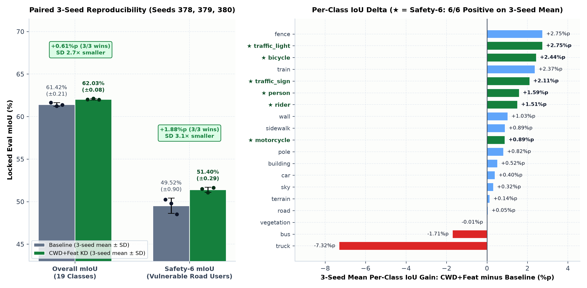
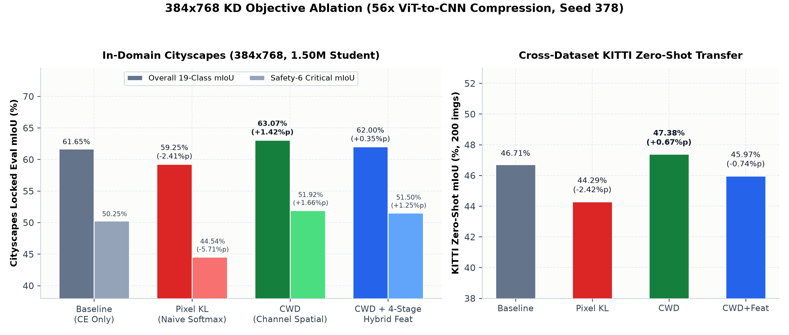
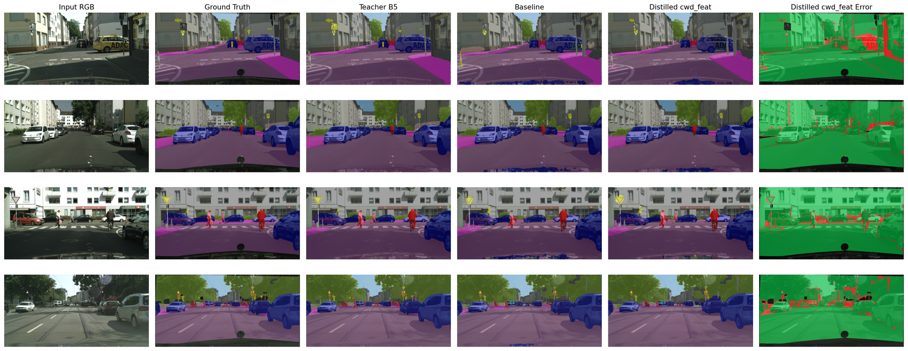
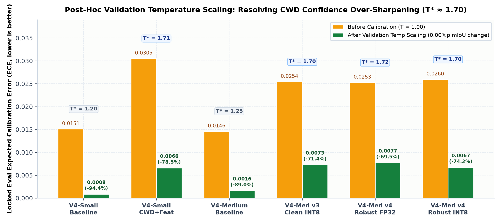

# 전체 실험 결과 및 실패 분석

[한국어 README](../README.ko.md) · [English](./results.md) · [아키텍처](./architecture.ko.md) · [검증 요약 JSON](../reports/final-summary.json)

모든 수치는 NVIDIA L4 (`22.03 GiB`, CUDA `12.8`, PyTorch `2.11.0+cu128`, BF16)에서 완료된 `v3-max` 및 `v4-final` 번들의 동결 JSON 리포트([`reports/final-summary.json`](../reports/final-summary.json))에서 직접 추출했습니다.

- **데이터셋 분할 (`manifest_sha256`: `e93018834b7e1e6b...`)**: Cityscapes 19클래스 `384×768` (`train 2,529` / `validation 446` / `locked_eval 500`) + KITTI Semantics 공식 200장 Zero-Shot(미세조정 0회)
- **평가 동결 해시**: `v3-max` (`6d48a65414aa91c2...`), `v4-final` (`8f235db63d5a427a...`)

---

## 1. 3시드 쌍체 검증 (`MobileNetV4-Small 1.50M`, seeds `378, 379, 380`)

동일 초기 가중치(`shared initial checkpoint`)에서 무교사 `baseline`과 4단계 하이브리드 `cwd_feat`를 쌍체 학습해 `locked_eval` 500장에서 평가했습니다.

| Seed | Baseline mIoU | CWD+Feat mIoU | Paired Gain | Baseline Safety-6 | CWD+Feat Safety-6 | Safety Gain |
|---:|---:|---:|---:|---:|---:|---:|
| `378` | 61.65% | 62.00% | +0.35%p | 50.25% | 51.50% | +1.25%p |
| `379` | 61.24% | 62.11% | +0.87%p | 49.79% | 51.07% | +1.28%p |
| `380` | 61.37% | 61.97% | +0.60%p | 48.51% | 51.63% | +3.12%p |
| **3-Seed Mean ± SD** | **61.42% ± 0.21%** | **62.03% ± 0.08%** | **+0.61%p ± 0.26%p (3/3 승)** | **49.52% ± 0.90%** | **51.40% ± 0.29%** | **+1.88%p ± 1.07%p (3/3 승)** |

- **분산 안정화 효과**: 지식 증류는 평균 mIoU 향상뿐 아니라 시드 간 표준편차를 전체 mIoU 기준 **2.7×**(`0.21% → 0.08%`), Safety-6 기준 **3.1×**(`0.90% → 0.29%`) 축소했습니다.
- **19클래스 3시드 평균 변화**: 6개 안전 핵심 클래스가 **6/6 전원 양수**(`traffic_light +2.75%p`, `bicycle +2.44%p`, `traffic_sign +2.11%p`, `person +1.59%p`, `rider +1.51%p`, `motorcycle +0.89%p`)였으며, 반면 희소 대형 차량 `truck(-7.32%p)`·`bus(-1.71%p)`에서 트레이드오프가 관측되었습니다.

---

## 2. 384×768 4종 증류 기법 소거 (`MobileNetV4-Small 1.50M`, `seed=378`)

| 증류 방법 | Locked mIoU (Δ) | Safety-6 mIoU (Δ) | Pixel Acc | Locked ECE | KITTI Zero-Shot (Δ) | KITTI Safety (Δ) |
|---|---:|---:|---:|---:|---:|---:|
| `baseline` (무교사 CE) | 61.65% | 50.25% | 93.12% | 0.0151 | 46.71% | 20.41% |
| `pixel_kl` (픽셀별 KL) | 59.25% (**-2.41%p**) | 44.54% (**-5.71%p**) | 92.86% | 0.0368 | 44.29% (-2.42%p) | 20.78% (+0.37%p) |
| **`cwd` (공간 CWD 단독)** | **63.07% (+1.42%p)** | **51.92% (+1.66%p)** | **93.28%** | 0.0296 | **47.38% (+0.67%p)** | **27.53% (+7.12%p)** |
| `cwd_feat` (CWD + 4단계 특징) | 62.00% (+0.35%p) | 51.50% (+1.25%p) | 93.22% | 0.0306 | 45.97% (-0.74%p) | 26.08% (+5.67%p) |

- **핵심 인사이트**: `84.6M → 1.50M` (`56×` 극한 이종 압축)에서는 순진한 `pixel_kl`이 안전 클래스를 `-5.71%p` 훼손하며, 반대로 채널별 공간 정규화(`cwd`)는 내부 표현 자유도를 유지하면서 Cityscapes(`+1.42%p`)와 KITTI Zero-Shot(Safety **`+7.12%p`**) 모두 최고점을 기록했습니다.

---

## 3. 3-Tier Pareto · Validation-Only INT8 게이트 · L4 BF16 속도

| 아키텍처 / 버전 | Params (Conv/BN) | FP32 / INT8 (MiB) | FP32 Argmax 일치 | Val mIoU 하락 | Val Safety 하락 | CPU p50 가속 | 게이트 판정 | Locked mIoU (FP32 → INT8) |
|---|---:|---:|---:|---:|---:|---:|:---:|---:|
| `MobileNetV4-Small` (`v3`) | 1.50M (57/55) | 5.72 → 1.76 (-69.3%) | 100.0% (`1.9e-5`) | 0.55%p | 0.42%p | 1.04× (16.8→15.9ms) | 미통과 (가속<1.2×) | 61.95% → 61.43% |
| `MobileNetV3-Large` (`v3`) | 3.30M (74/56) | 12.59 → 3.68 (-70.8%) | 100.0% (`2.4e-5`) | **6.46%p** | **6.06%p** | **0.72×** (24.2→33.2ms) | **차단 (FP32 롤백)** | 64.84% → 59.32% |
| **`MobileNetV4-Medium` (`v3-max`)** | **7.54M (88/86)** | **28.71 → 7.91 (-72.5%)** | **100.0% (`1.7e-5`)** | **0.95%p** | **0.77%p** | **1.55×** (38.1→24.7ms) | **통과 (INT8 선택)** | **68.51% → 67.95%** |
| **`MobileNetV4-Medium` (`v4-final`)** | **7.54M (88/86)** | **28.71 → 7.91 (-72.5%)** | **100.0% (`3.6e-5`)** | **0.64%p** | **0.43%p** | **1.55×** (40.3→26.0ms) | **통과 (INT8 선택)** | **67.35% → 66.96%** |

- **NVIDIA L4 CUDA BF16 실시간 지연(`384×768`, batch=1)**:
  - `Teacher SegFormer-B5`: `84.48 ms` (`11.84 FPS`)
  - `MobileNetV4-Small`: `11.07 ms` (`90.29 FPS`, **7.6× 가속**)
  - `MobileNetV4-Medium (v4 Robust)`: `17.48 ms` (`57.20 FPS`, **4.8× 가속**)

---

## 4. 사후 온도 보정 (Validation-Only Temperature Scaling)

| 모델 | 최적 온도 $`T^*`$ (Val) | 보정 전 ECE | 보정 후 ECE | ECE 감소율 | Locked mIoU 변화 |
|---|---:|---:|---:|---:|---:|
| `MobileNetV4-Small` Baseline | 1.20 | 0.0151 | 0.0008 | -94.4% | 0.00%p |
| `MobileNetV4-Small` CWD+Feat | **1.71** | 0.0305 | 0.0066 | **-78.5%** | 0.00%p |
| `MobileNetV4-Medium` Baseline | 1.25 | 0.0146 | 0.0016 | -89.0% | 0.00%p |
| `MobileNetV4-Medium` v3 Clean INT8 | **1.70** | 0.0254 | 0.0073 | **-71.4%** | 0.00%p |
| `MobileNetV4-Medium` v4 Robust FP32 | **1.72** | 0.0253 | 0.0077 | **-69.5%** | 0.00%p |
| `MobileNetV4-Medium` v4 Robust INT8 | **1.70** | 0.0260 | 0.0067 | **-74.2%** | 0.00%p |

- 모든 CWD 증류 모델이 모델 크기·양자화 여부·열화 학습 여부와 무관하게 정확히 `T* = 1.70~1.72` 범위로 수렴했습니다. 이는 CWD의 `T=4.0` 공간 분포 정렬이 학생 로짓 스케일을 일정 비율로 증폭시키는 구조적 특성 때문이며, 추론 시 단일 스칼라 나눗셈만으로 완전히 보정됩니다.

---

## 5. 실패 모드 및 구조적 원인 분석

1. **`MobileNetV3-Large` 정적 INT8 붕괴 (`-6.46%p`, `0.72×`)**: `Conv=74, BN=56` 구조에서 18개의 비융합 Squeeze-and-Excitation(SE) 게이트와 비대칭 HardSwish 활성화가 정적 QDQ 양자화 오차를 증폭하고 CPU Dequantize/Quantize 오버헤드를 유발했습니다. 반면 `Conv=88, BN=86`의 순수 UIB 블록 기반 `MobileNetV4-Medium`은 1.55× 가속과 `<1.0%p` 하락으로 게이트를 통과했습니다.
2. **Clean-Only 증류의 고주파 센서 노이즈 취약성 (`13.75%`)**: `v3-max` 학생은 깨끗한 이미지의 고주파 엣지 패턴에 과적합해 `σ=18` 가우시안 노이즈에서 배경 식생(`vegetation`) 오분류가 폭증했습니다. `v4-final`의 비대칭 강건성 증류는 이를 `59.59%`로 복원(`+45.84%p`)했습니다.
3. **희소 대형 차량(`truck`, `bus`) IoU 하락**: CWD는 19개 채널에 동일한 공간 가중치를 부여해 소형 안전 클래스(6/6 상승)를 강화하는 대신, 프레임 출현 빈도가 낮고 면적이 큰 `truck(-7.32%p)`·`bus(-1.71%p)`에서 소폭 경계 혼동이 발생했습니다.
