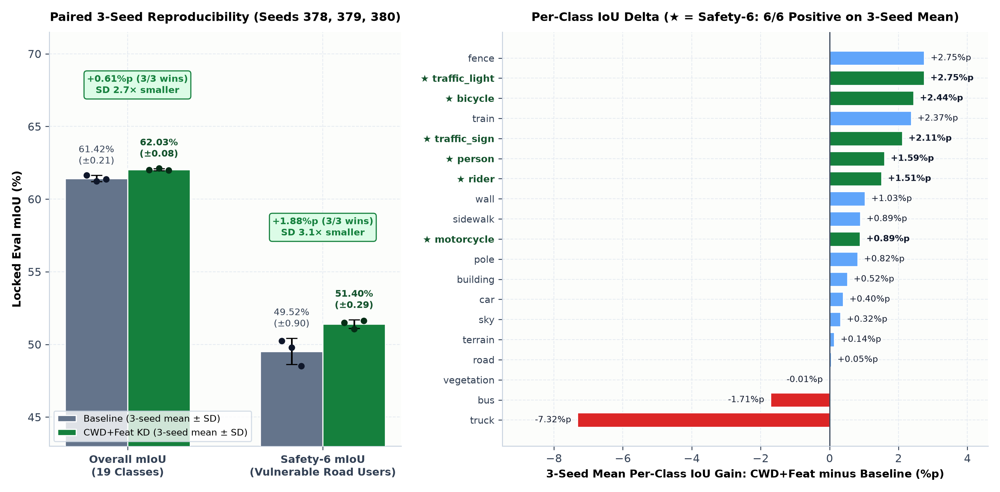
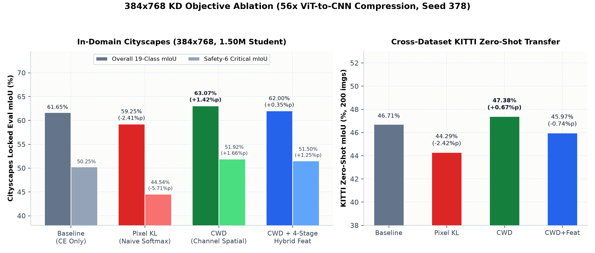
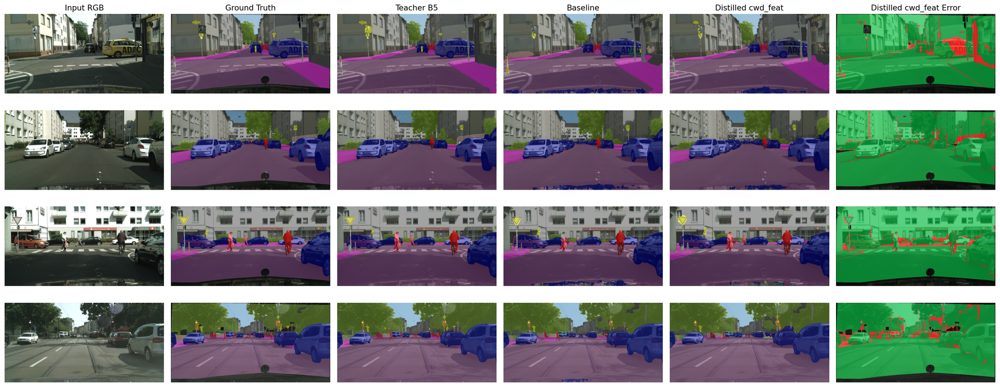
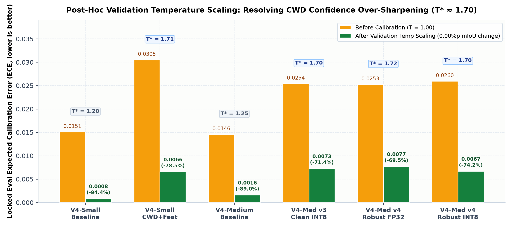

# Complete Experimental Results & Failure Analysis

[English README](../README.md) · [한국어](./results.ko.md) · [Architecture](./architecture.md) · [Summary JSON](../reports/final-summary.json)

Every metric below is extracted directly from frozen NVIDIA L4 (`22.03 GiB`, CUDA `12.8`, PyTorch `2.11.0+cu128`, BF16) artifacts in [`reports/final-summary.json`](../reports/final-summary.json).

- **Dataset Splits (`manifest_sha256`: `e93018834b7e1e6b...`)**: Cityscapes 19-class `384×768` (`train 2,529` / `validation 446` / `locked_eval 500`) + KITTI Semantics 200 official images Zero-Shot (zero fine-tuning).
- **Evaluation Freeze Hashes**: `v3-max` (`6d48a65414aa91c2...`), `v4-final` (`8f235db63d5a427a...`).

---

## 1. 3-Seed Paired Reproducibility (`MobileNetV4-Small 1.50M`, Seeds `378, 379, 380`)

| Seed | Baseline mIoU | CWD+Feat mIoU | Paired Gain | Baseline Safety-6 | CWD+Feat Safety-6 | Safety Gain |
|---:|---:|---:|---:|---:|---:|---:|
| `378` | 61.65% | 62.00% | +0.35%p | 50.25% | 51.50% | +1.25%p |
| `379` | 61.24% | 62.11% | +0.87%p | 49.79% | 51.07% | +1.28%p |
| `380` | 61.37% | 61.97% | +0.60%p | 48.51% | 51.63% | +3.12%p |
| **3-Seed Mean ± SD** | **61.42% ± 0.21%** | **62.03% ± 0.08%** | **+0.61%p ± 0.26%p (3/3 wins)** | **49.52% ± 0.90%** | **51.40% ± 0.29%** | **+1.88%p ± 1.07%p (3/3 wins)** |

- **Variance Stabilization**: Cross-architecture KD cuts seed-to-seed standard deviation by **2.7×** on overall mIoU (`0.21% → 0.08%`) and **3.1×** on Safety-6 mIoU (`0.90% → 0.29%`), improving **6/6 safety classes** on the 3-seed average (`traffic_light +2.75%p`, `bicycle +2.44%p`, `traffic_sign +2.11%p`, `person +1.59%p`, `rider +1.51%p`, `motorcycle +0.89%p`).

---

## 2. 384×768 4-Method Objective Ablation (`MobileNetV4-Small 1.50M`, `seed=378`)

| Method | Locked mIoU (Δ) | Safety-6 mIoU (Δ) | Pixel Acc | Locked ECE | KITTI Zero-Shot (Δ) | KITTI Safety (Δ) |
|---|---:|---:|---:|---:|---:|---:|
| `baseline` (CE Only) | 61.65% | 50.25% | 93.12% | 0.0151 | 46.71% | 20.41% |
| `pixel_kl` (Naive Pixel KL) | 59.25% (**-2.41%p**) | 44.54% (**-5.71%p**) | 92.86% | 0.0368 | 44.29% (-2.42%p) | 20.78% (+0.37%p) |
| **`cwd` (Spatial CWD Only)** | **63.07% (+1.42%p)** | **51.92% (+1.66%p)** | **93.28%** | 0.0296 | **47.38% (+0.67%p)** | **27.53% (+7.12%p)** |
| `cwd_feat` (CWD + 4-Stage Feat) | 62.00% (+0.35%p) | 51.50% (+1.25%p) | 93.22% | 0.0306 | 45.97% (-0.74%p) | 26.08% (+5.67%p) |

---

## 3. 3-Tier Pareto Frontier, Validation-Only INT8 Gate & L4 BF16 Latency

| Architecture / Profile | Params (Conv/BN) | FP32 → INT8 (MiB) | FP32 Argmax Parity | Val mIoU Drop | Val Safety Drop | CPU p50 Speedup | Gate Result | Locked mIoU (FP32 → INT8) |
|---|---:|---:|---:|---:|---:|---:|:---:|---:|
| `MobileNetV4-Small` (`v3`) | 1.50M (57/55) | 5.72 → 1.76 (-69.3%) | 100.0% (`1.9e-5`) | 0.55%p | 0.42%p | 1.04× (16.8→15.9ms) | Rejected (<1.2×) | 61.95% → 61.43% |
| `MobileNetV3-Large` (`v3`) | 3.30M (74/56) | 12.59 → 3.68 (-70.8%) | 100.0% (`2.4e-5`) | **6.46%p** | **6.06%p** | **0.72×** (24.2→33.2ms) | **Blocked (FP32)** | 64.84% → 59.32% |
| **`MobileNetV4-Medium` (`v3-max`)** | **7.54M (88/86)** | **28.71 → 7.91 (-72.5%)** | **100.0% (`1.7e-5`)** | **0.95%p** | **0.77%p** | **1.55×** (38.1→24.7ms) | **PASS (INT8)** | **68.51% → 67.95%** |
| **`MobileNetV4-Medium` (`v4-final`)** | **7.54M (88/86)** | **28.71 → 7.91 (-72.5%)** | **100.0% (`3.6e-5`)** | **0.64%p** | **0.43%p** | **1.55×** (40.3→26.0ms) | **PASS (INT8)** | **67.35% → 66.96%** |

- **NVIDIA L4 CUDA BF16 Latency (`384×768`, batch=1)**: Teacher `84.48 ms` (`11.84 FPS`), `MobileNetV4-Small` `11.07 ms` (`90.29 FPS`), `MobileNetV4-Medium (v4 Robust)` `17.48 ms` (`57.20 FPS`).

---

## 4. Validation-Only Post-Hoc Temperature Scaling

| Model | Optimal $`T^*`$ (Val) | ECE Before | ECE After | Reduction | Locked mIoU Delta |
|---|---:|---:|---:|---:|---:|
| `MobileNetV4-Small` Baseline | 1.20 | 0.0151 | 0.0008 | -94.4% | 0.00%p |
| `MobileNetV4-Small` CWD+Feat | **1.71** | 0.0305 | 0.0066 | **-78.5%** | 0.00%p |
| `MobileNetV4-Medium` Baseline | 1.25 | 0.0146 | 0.0016 | -89.0% | 0.00%p |
| `MobileNetV4-Medium` v3 Clean INT8 | **1.70** | 0.0254 | 0.0073 | **-71.4%** | 0.00%p |
| `MobileNetV4-Medium` v4 Robust FP32 | **1.72** | 0.0253 | 0.0077 | **-69.5%** | 0.00%p |
| `MobileNetV4-Medium` v4 Robust INT8 | **1.70** | 0.0260 | 0.0067 | **-74.2%** | 0.00%p |

---

## 5. Failure Mode & Root-Cause Analysis

1. **`MobileNetV3-Large` Static INT8 Collapse (`-6.46%p`, `0.72×`)**: 18 unfused Squeeze-and-Excitation (SE) branches and HardSwish activations (`74 Conv / 56 BN`) amplified static QDQ quantization error and inserted Q/DQ stalls on CPU. `MobileNetV4-Medium` (`88 Conv / 86 BN` pure UIB `Conv-BN-ReLU`) passed all four acceptance criteria cleanly.
2. **Clean-KD Sensor-Noise Fragility (`13.75%`)**: Clean-only distillation over-relied on high-frequency edge cues, misclassifying noisy roads and vehicles as vegetation under `σ=18` Gaussian noise. Asymmetric Robustness KD (`v4-final`) recovered `+45.84%p` (`59.59%`), outperforming the 84.6M teacher (`59.19%`).
3. **Rare Large-Vehicle Trade-Off (`truck -7.32%p`, `bus -1.71%p`)**: Equal per-channel spatial weighting in CWD strongly boosts small vulnerable road users (6/6 positive) at the cost of higher confusion on rare, low-frequency large vehicles in the `1.50M` capacity regime.
