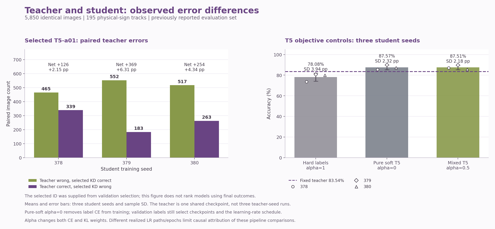

<a href="./teacher-student-analysis.md">English</a> | <strong>한국어</strong>

# 교사와 학생의 오류 차이 및 고정 T5 대조 실험

## 현재 대표 배포와 근거가 뒷받침하는 결론

대표 배포는 **T5-a05, 시드 378**을 유지합니다. 정확도 **87.06%, 5,093/5,850**, macro F1 **0.7903**, balanced accuracy **0.7817**입니다. 전체 9개 조합의 연구 선택은 검증 정확도 평균으로 결정한 **T5-a01** 그대로이며 동결된 보고서나 선택 결과를 수정하지 않았습니다. 뒤의 상세 T5-a01 오류 분석은 연구 선택 모델의 결과로 구분합니다.

| 동일 교사와 시드 378 학생의 비교 | 교사 오답, 학생 정답 | 교사 정답, 학생 오답 | 순증 정답 | 정확도 차이 |
| --- | --- | --- | --- | --- |
| **유지한 대표 배포, T5-a05** | **473** | **267** | **206** | **+3.52%p** |
| 연구 선택 T5-a01 | 465 | 339 | 126 | +2.15%p |
| 순수 증류 대조 T5-a00 | 455 | 345 | 110 | +1.88%p |

T5-a05의 트랙 재표집 구간은 이미 관찰한 참고 집합에서 **[+1.15, +5.79]%p**입니다. 관찰된 실제 표지판 트랙의 기술적 구간이며 독립 확인을 입증하지 않습니다. 수치는 [`summary.json`](../reports/full-grid/teacher-student-analysis/summary.json)의 `grid_T5-a05_seed_378-vs-teacher` 등 저장 예측 비교에 근거합니다. 간결한 [대표 배포 비교 기록](../reports/deployment/teacher-student-comparison.json)에 해당 모델의 역할을 명시합니다.

**결론은 학생이 교사의 최댓값 결정을 그대로 복제하는 대신 완화된 클래스 확률을 학습하며, 이번 실행에서 교사보다 높은 참고 정확도를 보였다는 것입니다.** T5-a00 순수 증류 대조도 세 시드 모두에서 교사를 넘었으므로 정답 CE를 추가한 사실만으로 교사 초과 성능을 설명할 수 없습니다. 교사와 혼합 증류 학생 모두 정답으로 학습하며 학생만 정답을 받은 구조도 아닙니다.

교사의 일부 계층 미세 조정과 고정 BN은 학생 전체 구조의 적응 및 갱신되는 BN과 다릅니다. 구조, 사전학습, 드롭아웃, 학습 예산, 실제 학습률 경로와 검증 체크포인트 선택도 차이가 있습니다. 이 확인된 차이는 서로 다른 예측을 설명할 후보이지만 각 요인의 인과 기여를 분리하지 않았습니다. 근거가 뒷받침하는 범위는 해당 실행에서 관찰한 참고 정확도 향상입니다. 압축 자체가 정확도를 높였다거나 학생이 항상 교사보다 낫다는 결론으로 확대하지 않습니다. [배포와 프로젝트 전체 결과](./deployment.ko.md)에 실행 비용과 재현성 및 한계를 함께 정리했습니다.

## 보존한 연구 선택 T5-a01의 상세 분석

검증으로 선택한 설정은 **T5-a01**입니다. 이 분석은 새로 동결한 참고 평가의 저장 예측과 학습 기록만 읽었으며 모델 실행, 재학습이나 재선택을 하지 않았습니다. 평가 집합 5,850장과 실제 표지판 트랙 195개의 결과는 이전부터 관찰된 집합에 대한 기술 분석입니다.

| 모델 | 정답 / 평가 | 정확도 | macro F1 | Balanced accuracy |
| --- | --- | --- | --- | --- |
| 교사 | 4,887 / 5,850 | 83.54% | 0.7465 | 0.7548 |
| 선택 학생, 시드 378 | 5,013 / 5,850 | 85.69% | 0.7719 | 0.7620 |

선택 학생과 교사의 macro F1 차이는 **+0.0254**, balanced accuracy 차이는 **+0.72%p**입니다. 교사 초과 여부의 조건은 동일 참고 평가 집합의 정확도와 정답 수입니다. 정확도가 높다는 사실을 모든 지표나 다른 평가 집합에서도 우수하다는 주장으로 확대하지 않습니다.

## 저장 예측으로 확인한 차이

| 시드 | 교사 오답, 학생 정답 | 교사 정답, 학생 오답 | 순증 정답 | 정확도 차이 (%p) | 트랙 재표집 구간 (%p) |
| --- | --- | --- | --- | --- | --- |
| 378 | 465 | 339 | 126 | +2.15 | [-0.14, +4.55] |
| 379 | 552 | 183 | 369 | +6.31 | [+3.90, +8.44] |
| 380 | 517 | 263 | 254 | +4.34 | [+1.79, +6.87] |

시드 378에서 교사의 오답을 학생이 맞힌 465개 중 **282개는 독립 학습 기준 모델도 이미 정답**이었습니다. 교사와 기준 모델이 모두 틀렸으나 학생이 맞힌 사례는 **183개**입니다. 모든 교사 오류 수정을 증류만의 효과로 계산하지 않습니다. 클래스 재현율은 학생이 높은 클래스 22개, 교사가 높은 클래스 14개, 동일한 클래스 7개입니다.

트랙 재표집 구간은 관찰된 실제 표지판 트랙 전체를 다시 뽑아 계산한 95% 백분위 구간입니다. 미사용 평가에 대한 확인, 교사 시드의 불확실성, 증류의 인과 효과나 도로 환경의 신뢰성을 입증하지 않습니다. 구간에 0이 포함되는 경우도 원래 값 그대로 보고합니다.

## 선택된 T5 설정의 대응 대조

선택된 **T5-a01**을 같은 시드의 독립 학습 기준과 순수 증류 **T5-a00**에 직접 대응시켰습니다. 아래는 동일 참고 평가 집합의 실측 정확도와 macro F1입니다. 뒤의 alpha 0.5 고정 대조는 별도 보조 분석이며 선택된 alpha 0.1의 결과를 대신하지 않습니다.

| 시드 | 정답 CE 정확도 | 정답 CE macro F1 | 선택 학생 정확도 | 선택 학생 macro F1 | 순수 KL 정확도 | 순수 KL macro F1 |
| --- | --- | --- | --- | --- | --- | --- |
| 378 | 73.56% | 0.6253 | 85.69% | 0.7719 | 85.42% | 0.7684 |
| 379 | 80.75% | 0.7216 | 89.85% | 0.8111 | 90.03% | 0.8329 |
| 380 | 79.93% | 0.7118 | 87.88% | 0.8164 | 87.25% | 0.7876 |

| 대응 비교 | 정확도 차이 평균 ± 표본 SD (%p) | 평균 macro F1 차이 |
| --- | --- | --- |
| 선택 − 정답 CE | +9.73 ± 2.16 | +0.1135 |
| 선택 − 순수 KL | +0.24 ± 0.41 | +0.0035 |

| 시드 | 실제 학습 에포크 동일 | 실제 학습률 이력 동일 |
| --- | --- | --- |
| 378 | True | False |
| 379 | False | False |
| 380 | True | False |

증류 온도 5, 같은 초기 가중치와 최대 예산의 규칙을 확인했습니다. alpha 0에서 0.1로 바꾸면 정답 CE를 추가하는 동시에 KL 혼합 계수를 1에서 0.9로 바꿉니다. 실제 학습률과 검증 체크포인트 선택도 목적 함수에 반응하므로 이 비교는 정답 CE만의 인과 효과를 분리하지 않습니다. 세 시드의 평균과 표본 SD는 개발 선택에 참여한 반복의 기술 통계입니다.

## 고정 T5의 정답, 혼합 및 순수 증류 보조 대조

이 대조는 온도 **5**, 혼합 **alpha 0.5**, 순수 증류 **alpha 0**와 독립 학습 **alpha 1**을 비교합니다. 전체 9개 조합에서 선택한 설정과 다를 수 있으며 선택 설정의 효과와 자동으로 동일시하지 않습니다. alpha 0 실험은 모델 선택에서 제외했습니다.

alpha는 정답 CE의 혼합 계수이며 실제 손실이나 기울기의 비율을 보장하지 않습니다. alpha 0.5와 alpha 0을 비교하면 정답 CE 항을 추가하면서 KL의 혼합 계수도 1에서 0.5로 바꿉니다. 따라서 이 차이를 정답 CE만의 인과 효과로 해석하지 않습니다.

| 시드 | 정답 CE, alpha 1 | 혼합, alpha 0.5 | 순수 KL, alpha 0 |
| --- | --- | --- | --- |
| 378 | 73.56% | 87.06% | 85.42% |
| 379 | 80.75% | 89.88% | 90.03% |
| 380 | 79.93% | 85.59% | 87.25% |

순수 증류 학생도 세 시드 중 **3개**에서 교사의 참고 평가 정확도를 넘었습니다. 해당 경우의 교사 초과 성능을 학생 목적 함수의 정답 CE 항만으로 설명할 수 없습니다. 교사 자체와 검증 체크포인트 선택에는 정답 레이블이 사용됐으므로 레이블을 전혀 사용하지 않은 학습이라는 뜻도 아닙니다.

| 대응 비교 | 정확도 차이 평균 ± 표본 SD (%p) | 평균 macro F1 차이 |
| --- | --- | --- |
| 혼합 − 정답 | +9.43 ± 3.93 | +0.1096 |
| 혼합 − 순수 증류 | -0.06 ± 1.65 | -0.0004 |
| 순수 증류 − 정답 | +9.49 ± 2.28 | +0.1100 |

| 시드 | 실제 학습 에포크 동일 | 실제 학습률 이력 동일 |
| --- | --- | --- |
| 378 | True | False |
| 379 | False | False |
| 380 | True | False |

초기 가중치, 데이터, 증강, 클래스 가중치와 최대 학습 예산의 규칙은 맞췄습니다. 실제 학습률과 조기 종료, 검증으로 선택한 에포크는 목적 함수에 따라 달라질 수 있습니다. 따라서 이 비교는 각 학습 절차의 결과이며 KL 항만의 인과 효과로 분해하지 않습니다.

## 해석의 한계

혼합 증류는 정답 CE와 온도로 완화한 교사 분포의 KL을 함께 최적화하므로 교사의 최댓값 클래스 결정을 그대로 복제할 필요가 없습니다. 정답 학습, 학생 구조와 증강 및 검증 체크포인트 선택은 서로 다른 예측을 만들 수 있는 설명 후보입니다. 오류 차이와 대조 결과가 모든 설명의 원인을 확정하지는 않습니다.

학습 정확도에는 증강, 학습 모드 드롭아웃과 정규화가 적용됐고 검증 정확도는 깨끗한 입력의 추론 모드 값입니다. 두 값의 차이를 같은 조건의 과적합 척도로 취급하지 않습니다. 저장한 신뢰도는 예측한 클래스의 최댓값 확률이며 실제 정답 클래스의 확률, 개별 KL, 엔트로피나 학습 기울기는 복구할 수 없습니다. 동일 교사를 공유한 세 학생 시드는 교사 학습 시드의 변동을 측정하지 않습니다.

## 동결 코드로 확인한 학습 절차의 차이

교사와 학생은 같은 학습 집합의 정답 레이블을 사용합니다. 각 클래스 가중치는 `N / (43 * n_class)`이며 교사의 정답 CE와 학생의 정답 CE에 모두 적용됩니다. 혼합 학생은 여기에 클래스 가중치를 적용하지 않은 교사에서 학생 방향의 KL과 `T^2` 보정을 더합니다. 학생만 정답 정보를 가진 구조로 설명하지 않습니다. 근거: [data.py:242](../knowledge_distillation/data.py#L242), [교사의 가중 CE](../knowledge_distillation/training.py#L159), [학생의 가중 CE](../knowledge_distillation/training.py#L250), [손실 결합](../knowledge_distillation/losses.py#L17).

| 확인 항목 | 교사 | 학생 | 코드 근거 |
| --- | --- | --- | --- |
| 구조와 초기화 | ImageNet MobileNetV2와 새로운 43클래스 분류 헤드 | 새로 초기화한 3층 SeparableConv MicroCNN | [models.py:20](../knowledge_distillation/models.py#L20), [training.py:147](../knowledge_distillation/training.py#L147) |
| 가중치 적응 범위 | 분류 헤드 학습 후 백본의 마지막 최대 60층만 미세 조정 | 전체 소형 구조의 학습 가능 가중치를 최적화 | [models.py:69](../knowledge_distillation/models.py#L69), [losses.py:104](../knowledge_distillation/losses.py#L104) |
| 배치 정규화 | MobileNetV2 BN 고정, 백본은 추론 모드로 호출 | 세 BN 계층은 학습 모드에서 갱신 | [models.py:62](../knowledge_distillation/models.py#L62), [models.py:80](../knowledge_distillation/models.py#L80), [losses.py:97](../knowledge_distillation/losses.py#L97) |
| 분류기 드롭아웃 | 0.3 | 0.2 | [models.py:34](../knowledge_distillation/models.py#L34), [models.py:64](../knowledge_distillation/models.py#L64) |
| 최대 학습 예산과 초기 학습률 | Adam, 헤드 5에포크와 0.001, 미세 조정 15에포크와 0.00001 | Adam, 최대 30에포크와 0.001 | [training.py:152](../knowledge_distillation/training.py#L152), [training.py:255](../knowledge_distillation/training.py#L255) |
| 증강 규칙 | 밝기 0.2, 대비 0.2, 확대 및 축소 0.05 | 동일한 증강 종류와 강도 | [models.py:8](../knowledge_distillation/models.py#L8) |
| 입력 전처리 | RGB 96 bilinear, 외부 [0,1] 입력을 그래프 안에서 [-1,1]로 변환 | RGB 96 bilinear, [0,1] 입력 및 증강 후 범위 제한 | [data.py:292](../knowledge_distillation/data.py#L292), [models.py:55](../knowledge_distillation/models.py#L55), [losses.py:88](../knowledge_distillation/losses.py#L88) |

증류 중 교사는 저장된 가중치를 유지하며 `training=False`로 호출합니다. 교사의 드롭아웃과 내부 증강을 다시 켜서 잡음을 추가하는 절차가 아닙니다. 반면 학생은 학습 모드로 호출합니다. 두 학습 절차가 증강 규칙을 공유한다고 해서 교사와 학생의 모든 시드, 학습 단계와 에포크에서 동일한 증강 이미지가 실현됐다는 뜻은 아닙니다. 근거: [losses.py:86](../knowledge_distillation/losses.py#L86), [교사 불변성](../knowledge_distillation/training.py#L246).

둘 다 검증 정확도가 높은 체크포인트를 선택하고 patience 5를 적용하지만, 학습률 감소는 각 모델의 검증 CE 이력에 반응합니다. 목적 함수와 기록이 달라 실제 학습률, 종료 에포크와 선택 에포크는 달라질 수 있습니다. 위 대조 표에 실제 일치 여부를 보고하며, 정책을 맞췄다는 사실을 실제 학습 경로가 동일했다는 주장으로 바꾸지 않습니다. 근거: [공통 콜백](../knowledge_distillation/training.py#L91).

확인된 사실은 교사의 사전학습 및 부분 적응, 학생의 전체 구조 적응, BN와 드롭아웃, 학습 예산과 목적 함수가 다르다는 것입니다. 어느 차이가 일반화나 오류 수정에 기여했는지는 실제 오류 및 고정 T5 대조 결과와 함께 검토할 설명 후보입니다. 이 비교는 압축 자체가 정확도를 높였다는 증거도, 정답 CE만이 교사 초과 성능을 만들었다는 증거도 아닙니다.

근거: [`reports/full-grid/teacher-student-analysis/summary.json`](../reports/full-grid/teacher-student-analysis/summary.json). 전체 조합과 공개 평가 명령은 [확장 실험 보고서](./full-grid.ko.md)에 정리했습니다.
